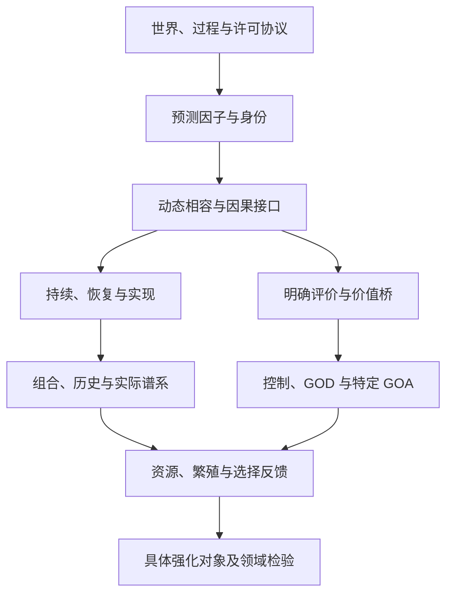

# 主编数学总审查与依赖说明

## 1. 对象、责任和判断

本轮升级对象是 `3d443ec29eb17af1fc00699a74e2d42d73516d81` 上实际存在的 v4.0 数学著作：核心总论 I—VII、第 0—39 章及附录 A—F。第 39 章已经有 95 节。主编从现稿与源索引重建范围，采用 A 的全书中文数学读审、B 的逐章中文教学编辑和 C 的英文编辑，统一批准最小中文修订与完整英文合并。没有从早期路线图推断当前缺口，没有把旧 OPEN 阶段复活为新任务。

本报告是本轮主智能体的实际总审查，不是外部人类同行评议。A、B、C 的交叉审阅与翻译作者分离；作者自检另行记录。主编亲自审核全书依赖、当前源合同和关键语义边界，完成总论、§39.1—30、附录 A—F 的完整英文翻译；另完整逐段读审 A 的第 32—38 章英译，包括 35 个 M 命题及其证明、反例和接口说明。0—31 章及后继来源的逐项中文数学审查见 A 的矩阵与 106 条备注；英文完整分离审译覆盖见下表。未把主编索引检查或机器计数说成逐行重证全部 Lean 依赖。

最小编辑没有发现必须在本次修改冻结 Lean 的实质反例；这是一项有范围的审查结论，不是“全库绝无错误”的保证。已发现的真实引用错误、证明出处错误和翻译漂移全部保留证据、修订及影响范围。

## 2. 真实依赖结构

下表中的箭头表示使用前层数据后增加何种假设，不表示前层定义自动蕴含后层性质。对应章和反例来自正式双语正文及 [完整来源矩阵](../../THEOREM_SOURCE_MATRIX.md)。

| 层次与位置 | 输入、问题与数学产物 | 必须保留的额外条件和不蕴含项 |
|---|---|---|
| 世界、过程、协议（0—3） | 先给过程、允许观察/干预及候选表示，定义轨迹律、信息因子和接口 | 标准 Borel、可测性、正则条件分布或有限模型各有范围；世界不是从表示定义中制造出来 |
| 预测身份（4—6） | 可数测试族的预测核得到最小预测因子、相容更新及表示唯一性 | a.e. 共同版本与逐点版本不同；不可数族不能无条件取共同零集；预测身份不等于载体身份或程序来源 |
| 动态与因果（7、11—12、17、20） | 纤维相容使动力学下降；允许干预及因果接口另行约束 | 被动预测充分性不提供干预闭合；观察、奖励、全部动作转移的闭合义务分别检查；商空间/可测选择不自动存在 |
| 持续、恢复、准平稳（8—10、19、21） | 不变核、可行核、Lyapunov 漂移、条件生存律给不同持续结论 | 期望恢复不等于每条路径收缩；QSD 不等于永生；有限支持可行性不自动升级为同一策略无限期安全 |
| 载体、尺度、组织形成（13—17、32—35） | 极小载体、分辨率、路径不可因子化和父层接口把语义连接到明确机制 | 访问擦除与物理损坏之间需要 frame；clutter 的有限条件不可删；程序来源不从纯物理读出恢复 |
| 评价桥与控制（18—24） | 明确评价、策略类及折扣等条件后定义 Bellman 值与集合值 GOD | 结构不唯一决定价值；安全受限模型与原动作模型不同；GOA 的不变律/Cesàro/QSD 类型不能混用；最优策略类不等于指定程序 |
| 再生、繁殖、继承和选择（25—27、总论及39） | 原生事务、实际出生谱系、资源和遗传合同使 Price、增长与反馈成为同源结论 | 正出生数才正规化；样本比率不等于期望之比；保留亲本与新生子代不同；外部资源、保护代码和传感权限不能省略 |
| 残差、训练与部署（16、28、36—38） | 同一个实际路径联合律、后验支持、占据平均和 Good 事件控制误差 | 单时点边缘不能替换占据；训练律不能替换部署律；实际漏失质量必须保留；有限支撑的非对称条件不可改写为双方有限 |
| 强化对象和领域扩展（29—31、39） | 将一般 Core 与所列机制、时间、费用、观察和统计条件装配 | 强化对象不是任意自然对象；连续源、组织恢复、持久未知参数和有限钱包各自需要实际来源；经验支持保持 UNVERIFIED |

图只给依赖方向。表中每一附加条件仍属于其定理；“统一闭合”不能省略它们。原有 D/P/K/H/E/N/O 继续表示定义、数学证明、标准定理、外部机制假设、经验支持、反例/不可识别和开放问题；审查完成状态不是第二套数学真值体系。

## 3. 冻结 Core 与后继结果

106 个原始 P-ID 的身份未变，原 Core v3.0 SHA-256 为 `ed00dd102157cdafe3a79c45506e86dc574d6cba65feb2df8686e63ce2726303`。来源矩阵把它们与 163 个实际 Lean 声明对应；163 是注册端点数，不是新的 P-ID 数。11 generated、89 retained_adapter、6 retained_boundary 及四个计数生成器继续使用原账本的具体含义。

42 个 M 编号、总论的综合命题与第 39 章各来源族属于后继层次。95 个后继小节不是 95 条独立定理。有些段落同时包含实际构造、消费者、反例和模型限制，因此完整性通过逐段读审及来源账本确认，而不通过简单节数确认。

增长部分严格保留 `max(1,kc,(1-q)kb+qkc)` 的期望比较目标、两个内部程序各自的达到条件、完整许可历史实随机策略类、真实拒绝行为、六单位钱包及遗传机制。已形式化的是有限时间期望指数上界及最小正公共基数；n 次根/limsup 为书面推论，不写成几乎必然人口增长。同源任务的 2/3/4 最小表示以及 `(s,b,bq)` 的秩三仍按书面证明与精确计算层次处理，未伪称新增完整 Lean 端点。

## 4. 主要纠错与依赖影响

| 问题 | 审定处理 | 下游影响 |
|---|---|---|
| P-REC-02 右侧 W(x) 的初态依赖不够局部明确 | 两端明确固定 X₀=x | 只显式重述已有初态合同；不改 Dynkin、可积性或期望界 |
| P-CAR-03 脱离上节后容易丢 clutter 条件 | 两端重述有限 V 上的 clutter | 不把任意集合族误写成双 blocker 恒等式；Lean 原条件不变 |
| §36.8.1 的 Q_n 跨类型复用 | 局部说明它是参考核，非 §36.1 的历史投影 | 公式不变；防止把函数当核使用 |
| §39.42 的“最大格比”含义不足 | 明确定义为绝对二阶 Taylor 余项/增量平方范数，零增量比值为零 | 英文不再误译成状态振荡；Itô 假设及收敛层次不变 |
| M-38.6 的证明末步引用了错误 M 编号 | 明确 M-38.1 塔式公式和 M-38.3 混合界各自作用 | 纠正证明来源；Good 事件、风险预算和源计算不变 |
| C.4 的 Aubin 旧链接属于凸优化稳定性论文 | 改用真实 Aubin–Cellina 微分包含/可行性著作，并增加完整书目 | 真实文献归属错误，未发现因此造成冻结源定理错误 |
| 历史 OPEN/待连接与当前状态混写 | 保留历史时点，指向后继节及现行 CURRENT | 不删除历史失败，也不把当前范围外问题说成已解 |
| 英译 §39.77 曾声称对零概率反事实行加合法性要求也不缩小比较类 | 改成不施加这种额外要求 | 实质翻译纠正，保留原全比较类；中文与 Lean 原结论没有被修改 |
| 附录 F 的 M-36.6 容易被译为双方有限 | 保留“一侧有限支撑”的实际前提 | 防止收窄或换掉适配定理类型 |
| 本轮索引工具被后续加粗引用覆盖定位，并误收算术 K−1 | 修复定位规则，重新生成并交叉检查 | 审计工具自身缺陷透明记录，不归咎于源书数学 |

完整精确 old/new、导读复核的七处消歧和全部翻译纠错见同目录 JSON 及 [数学语义审计](../../FORMAL_SEMANTIC_AUDIT.md)。没有新增定理，也没有将猜想、机制假设或经验状态升为已证。

## 5. 完整双语分离审查

| 正式范围 | 翻译责任 | 非该段翻译作者的复核 |
|---|---|---|
| 总论 I—VII、39.1—30 | 主编 | A，ROOT_TRANSLATION_CROSS_REVIEW.md |
| 0—17、39.31—60 | C | B，INDEPENDENT_TRANSLATION_REVIEW_B.md 及 102 项覆盖记录 |
| 18—31、39.61—95 | B | C，CROSS_REVIEW_B.md/LEDGER；全部段落及关键命题逐项对照 |
| 32—38 | A | 主编，完整通读 35 个 M 陈述/证明、接口和反例 |
| 附录 A—F | 主编 | B，完整审阅并精确纠偏；D 三段围栏代码另作字节核对 |
| 46 个新增章/附录导读 | B | C，46 项全量审阅；七处双语消歧后统一采用 |
| 版权前置说明、C.5 书目及最终合并 | 主编 | 主编对照政策和原始网页核验；结构与文件身份另行绑定，不冒称外部独审 |

主编在第 32—38 章重点检查：八种层级不能由一个万能算子替代；四种生成机制不能掩盖保留适配器；P12 不从定义自动生成程序；安全与收益的动作比较类一致；有限路径误差使用实际后验与占据；有限支撑编码的不对称前提；正历史支持上的可行双向量词；训练—选择—部署使用同一个联合律和同一个 Good 事件。英文没有发现这些边界的剩余实质漂移。

机器检查比较有序公式、编号、证明结束、代码及链接；显式白名单翻译 32 个公式文字标签，另精确登记两处英文 a.e. 缩写的重复句点修正；没有通用删除标点规则。它不能捕捉所有自然语言量词漂移：测试特意把 every 改成 some，结构检查仍通过。此反向控制保留在报告中，防止把自动 PASS 当数学语义证明。

## 6. 仍然真实存在的限制

- 本轮没有重编译 Lean 全库、运行原历史 Python 枚举、或创建新的自然实验；源码身份及历史回执复用是另一个证据层。
- 静态声明读审须连同 namespace、section 参数、structure 字段及具体消费者理解；短包装 theorem 的名称不能替代真实前提。
- 标准可测选择、Girsanov、可行性、谱理论等外部结果仍要求正确的数学条件。书目核验提供真实出处，不代表本轮逐页重证这些专著。
- 本轮多智能体分离审查有共同工具和模型背景，不能替代外部数学研究者的同行评议。正式出版可据本版进行此类审阅。
- 经验状态 UNVERIFIED、特定机制权限、资源、时钟和评价假设保持公开；数学模型成立不表示自然界已经满足它。

最终文件散列、实际构建、全页视觉覆盖及 GitHub 身份由本目录的验收记录接续。后续若改变数学主张或源码，必须依新差异重新审查，不能继承本版全部验收。
