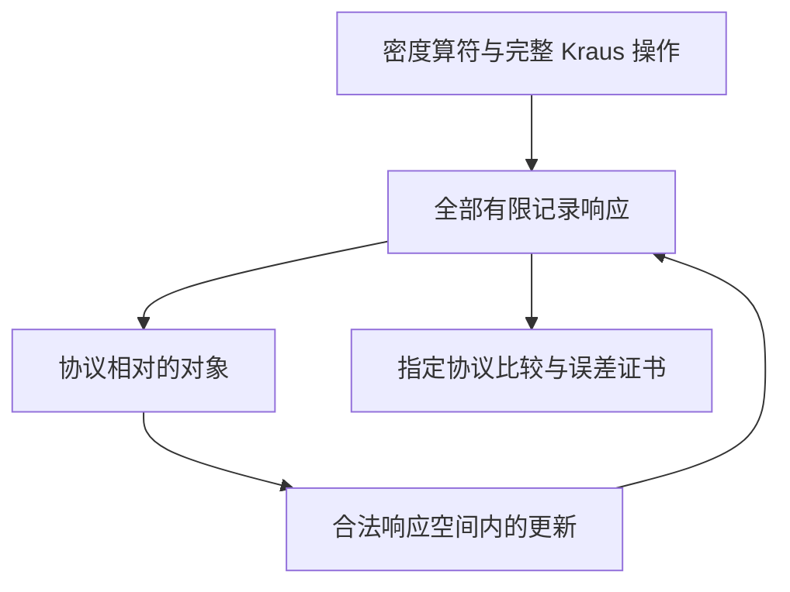

# UEOT-QM v31.1：第一操作内核

日期：2026-10-19  
承接：v31.0 升级方案、v23–v30.11 研究链、Core v3 数学接口  
实现入口：[kernel/README.md](kernel/README.md)  
验收依据：[主张台账](status/CLAIM_LEDGER_v31.1.json)、[Lean 回执](kernel/evidence/lean-verification.json)、[运行回执](kernel/evidence/runtime-verification.json)

## 1. 本轮结论与内核验收

本轮将 v31.0 的首个执行切片落实为 **UEOT-QM Kernel 1**：给定有限复量子扇区与明确的操作协议，内核产生合法记录、构造协议相对的对象表示、执行带零证据处理的递归更新，并提供范围明确的比较与误差证书。首版同时包含三代条件选择的独立 Lean 模块。

内核具有定义域、输入合同、状态更新、输出律和验收证据。后续 QDRR、连续变量、开放系统、QFT/EFT 与代际物理模型，可按这些接口接入；它们的物理输入和新增证明仍各自登记。

本轮验收包含五项：

1. **量子合法性**：从密度算符与 Kraus 完整性推导分支正性、概率归一化和正概率后验。
2. **对象合同**：所声明协议的全部有限记录响应确定操作等价类，并存在唯一响应商下降。
3. **递归闭合**：任意等价物理代表给出相同更新；正概率更新留在可实现响应空间，零概率返回显式空结果。
4. **可执行表示**：精确求解所需的有限响应空间，并只使用响应坐标推进记录预测。
5. **证据与适用范围**：有限协议比较、标量误差链、Lean 定理、程序回归和现实物理接入分别保留自己的前提。

实际验收已通过：**五个 Lean 模块的 56 个 theorem 声明及统一入口编译成功，59 个审计声明只依赖标准基础公理；32 个独立运行测试方法全部通过。** [成功工作流 39270031506](https://github.com/MurphyHoops/UEOT/actions/runs/39270031506) 绑定提交 `0791ea34f1ba108c738915921f8e7d923371d0cd`。验收回执记录源码哈希、构建结论与实际公理输出；[领域验收 memo](audits/KERNEL_REVIEW_20261019.md) 说明审查范围与后续文档提交的身份关系。

## 2. 理论核心：对象、协议与量子扇区

Core 的关键结构是“对可区分响应取商，并让更新尊重这个商”。量子力学提供本轮的具体扇区：有限复矩阵、PSD 锥、迹配对和 Kraus 操作。两者在合法记录这一层连接。

设

\[
\mathcal D_d=\{\rho\in M_d(\mathbb C):\rho\succeq0,\ \operatorname{tr}\rho=1\}.
\]

固定操作库 \(\{\mathcal I^{a}_{o}\}\)，以及由该库组成的所有有限因果协议类 \(\Pi\)。有限动作—结果词 \(w\) 的响应为

\[
R_\rho(w)=\operatorname{tr}(\mathcal I_w(\rho)).
\]

对象等价关系与可实现响应空间为

\[
\rho\sim_\Pi\sigma
\iff \forall w,\ R_\rho(w)=R_\sigma(w),
\qquad
\mathcal R_\Pi=\{R_\rho:\rho\in\mathcal D_d\}.
\]

在固定合同下，对象 \([\rho]_\Pi\) 足以决定全部允许的有限记录预测。改变操作库、结果含义、时间约束或后续协议时，必须重新说明等价关系及表示之间的接入方式。

完整层析协议能够恢复密度态的区分能力；受限协议可能把不同密度态合并。这里得到操作意义下的对象表示。更少响应坐标并不自动给出更小 Hilbert 空间中的 CPTP 实现。

复 Hilbert 扇区、Born 迹配对和操作库是本轮明确输入。Core 的一般响应商定理本身不选择这套量子扇区。v24.4 的量子重构研究继续保留其独立背景与原则。

## 3. 合法量子操作与记录

对动作 \(a\)、结果 \(o\)、有限 Kraus 指标 \(k\)，规定

\[
\mathcal I^a_o(X)=\sum_kK^a_{ok}X(K^a_{ok})^\dagger,
\qquad
\sum_{o,k}(K^a_{ok})^\dagger K^a_{ok}=I.
\]

Lean 输入结构只接收 Kraus 算符与完整性恒等式。以下性质由此推导：

\[
X\succeq0\Rightarrow\mathcal I^a_o(X)\succeq0,
\]

\[
p(o\mid a,\rho)=\operatorname{tr}\mathcal I^a_o(\rho)\ge0,
\qquad
\sum_op(o\mid a,\rho)=1.
\]

当 \(p>0\) 时，

\[
\rho_{a,o}=\mathcal I^a_o(\rho)/p\in\mathcal D_d.
\]

在 PSD 输入上，分支质量为零当且仅当分支算符为零。因此，零概率结果返回 `None` / `none`，没有任意填入后验密度态。

### 辅助系统与完全正性

形式化构造

\[
X\mapsto\sum_k(K_k\otimes I_\nu)X(K_k\otimes I_\nu)^\dagger,
\]

对任意有限辅助系统及任意联合 PSD 输入证明正性。逐矩阵元定理进一步将它识别为原映射的恒等放大；联合输入可包含纠缠。

可执行验收使用 Bell 态作为正例，并验证 Bell 态的部分转置不是 PSD。这使单系统正映射与完全正映射的区别成为一个实际反例测试。

### 记录组合

有限记录词连续组合未归一化分支，最后取迹，避免重复归一化。Lean 证明固定有限控制序列的全部结果权重之和为 1。Python 另实现完整有限因果树，允许动作依赖已观察结果，并检查每个节点覆盖完整结果集。

适应控制的归一化由树深归纳、逐动作归一化得到。本版尚未另建 Lean 因果树数据类型和树归纳定理：其机器表面是全部有限词与固定控制序列；因果树部分有实现、独立回执及上述数学接入理由。

## 4. 无限多个有限词的有限表示

所有有限词的集合通常无限，但固定有限维扇区需要的线性效应空间有限。

定义

\[
W_0=\operatorname{span}_{\mathbb R}\{I\},
\]

\[
W_{n+1}=\operatorname{span}_{\mathbb R}
\left(W_n\cup\bigcup_{a,o}(\mathcal I^a_o)^*W_n\right).
\]

由于 \(\dim_{\mathbb R}\operatorname{Herm}_d=d^2\)，严格增维至多发生 \(d^2-1\) 次。达到 \(W_{n+1}=W_n\) 后，空间对全部允许分支拉回封闭，得到 \(W_*\)。

\(W_*\) 恰等于所有有限词效应的张成，证明有两个方向：

- 从 \(I\) 反复做分支拉回，每个生成元都是一个有限词效应，所以算法没有加入词效应张成之外的方向。
- 稳定空间含 \(I\)，并对分支拉回封闭；按词长归纳，任意有限词效应都在其中。

取实基 \(B_0=I,B_1,\ldots,B_{r-1}\)，令

\[
x_j(\rho)=\operatorname{tr}(\rho B_j).
\]

则

\[
x(\rho)=x(\sigma)\iff R_\rho=R_\sigma.
\]

每个分支有唯一基坐标矩阵

\[
(\mathcal I^a_o)^*B_j=\sum_i(A_{a,o})_{ji}B_i.
\]

内核实际执行

\[
y=A_{a,o}x,\qquad p=y_0,\qquad
x'=y/p\quad(p>0).
\]

更新阶段无需重构密度矩阵。基效应来自实际有限词；编码从合法密度态进入，并由合法分支继续产生。

**机器覆盖**：Lean 证明的是全部有限词响应的商与递归性质。本版 \(W_*\) 张成定理、高斯消元正确性、有限基坐标与函数响应之间的完整 refinement 尚未形式化。上述有限维论证是数学证明；Python 算法有精确计算和独立对照。二者不能登记成“Python 已由 Lean 验证”。

### 可复算实例

| 可用动作 | 响应维数 \(r\) | 非恒定坐标数 \(r-1\) | \(\lvert+\rangle,\lvert-\rangle\) | Y 的正负本征态 |
|---|---:|---:|---|---|
| Z 测量 | 2 | 1 | 合并 | 合并 |
| H 控制、Z 测量 | 3 | 2 | 可区分 | 合并 |
| H、S 控制、Z 测量 | 4 | 3 | 可区分 | 可区分 |

\(r\) 包含恒定迹坐标 \(x_0=1\)。三者的 Hilbert 维数始终为 2；表中变化是协议区分能力及表示坐标数。

本轮库固定且时齐，每个动作每一步均可用。若只允许某个时间层、自动机或受限控制语言，需构造相应分层/扩充对象；对完整库求出的 \(W_*\) 仍可充分，却不保证对较小协议语言最小。

## 5. 闭合递归对象与实际 Core 复用

若 \(R_\rho=R_\sigma\)，单步概率相等。正概率分支满足

\[
R_{\rho_{a,o}}(w)=
\frac{R_\rho((a,o)::w)}{p(o\mid a,\rho)}.
\]

全词协议对前缀封闭，故后验响应也相等；零概率分支同样一致。由此得到

\[
U_\Pi:\mathcal R_\Pi\times(A\times O)
\longrightarrow\operatorname{Option}(\mathcal R_\Pi).
\]

返回类型携带“更新后仍可实现”的见证，能够继续用同一函数推进。`none` 对应零证据。去掉子类型见证的投影，与原条件响应更新一致。

| Core 接口 | QM 实际提供的合同 | 结论 |
|---|---|---|
| `QuotientDescent.existsUnique_descend` | 真实响应、满射商、纤维一致性 | 唯一响应 decoder |
| `RecursiveSufficientState.existsUnique_reachableUpdate` | 由前缀记录比值证明的更新纤维相容 | 可实现响应空间上的唯一递归更新 |
| `TransportCertificate.weighted_chain_bound` | 误差与预算的有向差、非负传播系数、逐步残差界 | 标量误差链证书 |

这些是已有定理的真实调用。本次保持冻结 Core 源码和计数台账不变。

### 环境记忆

当模型省略了相关环境，系统密度态一般不能决定未来。本轮反例是

\[
\rho_{SE}^{(1)}
=\tfrac12(|00\rangle\langle00|+|11\rangle\langle11|),
\quad
\rho_{SE}^{(2)}
=\tfrac12(|01\rangle\langle01|+|10\rangle\langle10|).
\]

两者的系统边缘态和环境边缘态都为 \(I/2\)。做环境控制、系统为靶的 CNOT，再测系统 Z，前者确定输出 0，后者确定输出 1。内核在联合空间上正确区分它们。要使用系统级压缩，需独立记忆/重置合同，或转向联合状态和过程表示。

## 6. 比较与误差证书

### 有限协议比较

`compare_finite_protocols` 对指定准备配对与有限因果树逐项生成完整记录律，计算

\[
\Delta_{\rm listed}=\max_{(\rho,\sigma),\pi}
\frac12\sum_r|P_{\rho,\pi}(r)-Q_{\sigma,\pi}(r)|.
\]

证书绑定双方操作库、准备矩阵、名称和完整协议结构，拒绝空覆盖。动作/结果名称之间的物理对应由接入方声明。

仅比较 Z 时，\(\lvert+\rangle,\lvert-\rangle\) 的有限协议差为 0；增加 H→Z 后，最大差为 1。有限覆盖的 0 无法推广到未列出的后续协议，也不能自动命名为一致通道误差或 diamond norm 上界。

### M-TC 误差运输

假设

\[
e_{n+1}\le L_ne_n+\epsilon_n,\qquad L_n,\epsilon_n,e_n\ge0,
\qquad e_0\le b_0,\quad b_0\ge0.
\]

预算为

\[
B_0=b_0,\qquad B_{n+1}=L_nB_n+\epsilon_n.
\]

真实 Core 复用证明

\[
0\le e_n\le B_n,\qquad B_n\ge0.
\]

`transport_budget` 计算条件式预算；`verify_transport_trace` 实查输入轨迹初值及每一步不等式。即使轨迹落在宽的全局预算内，只要局部递推失效，也不能获得通过证书。

应用仍须证明其量子距离满足指定的 \(L,\epsilon\)。本版尚未证明任意量子通道的统一 norm 收缩合同。

### 后选择

事件 \(E\) 在双方都必须有正概率。精确有限分布证书使用保守界

\[
\operatorname{TV}(P(\cdot\mid E),Q(\cdot\mid E))
\le\min\left(1,\frac{2\operatorname{TV}(P,Q)}
{\min(P(E),Q(E))}\right).
\]

两侧事件质量为 \(1/100\)、原 TV 为 \(1/100\) 的实例，可以在条件化后达到 TV=1。内核保留该放大并拒绝零证据。这一计算尚未登记为独立的 Lean 一般条件化界。

## 7. 三代：确切结论与物理接入

主命题为

\[
N_c,N_f,k\in\mathbb N,\quad N_c\ge3,\quad N_f>0,\quad k\le N_f,
\]

\[
2N_ck+N_f=N_cN_f,\qquad N_f(N_c+1)<22
\]

推出

\[
\boxed{N_c=3,\quad N_f=3,\quad k=1}.
\]

**primitive/atomicity 不是前提。** \(k\le N_f\) 保留在领域接口中；本版未宣称签名的每个条件都达到逻辑最小。

异常方程给出 \(N_c\mid N_f\)。写成 \(N_f=N_ct,\ t\ge1\)，预算成为

\[
tN_c(N_c+1)<22.
\]

\(N_c\ge3\) 意味着 \(N_c(N_c+1)\ge12\)，因此 \(t=1\)，且 \(N_c\in\{3,4\}\)。异常方程要求 \(2k=N_c-1\)，奇偶性排除 4，只剩 \(N_c=N_f=3,k=1\)。

Lean 采用完整有限化：先由前提证明 \(N_c\le20,N_f\le5\)，再穷尽这些经证明的界内整数情形。有限界来自前提，因而该证明不同于任意截断的数值搜索。

模块还核对删前提与复制对照：去掉色群下界有四代；去掉弱预算有六代；去掉异常方程有一代；允许空谱有零代。整包复制保持 cubic cancellation，但至少两个三代包违反给定弱预算。

### 接入现实物理的合同

| 层 | 接入内容 | 本版状态 |
|---|---|---|
| P：标准输入 | 表示异常贡献、共轭符号、弱作用计数规则 | 模型计算输入 |
| S：扇区选择 | 同质轻子模板、quark 的 \(R/\bar R\)、适用色群 | 待模型选择或独立解释 |
| B：计数桥 | 完整谱逐项求和，导出异常方程与预算计数 | 下一项可闭合任务 |
| E：有效窗口 | families 同时活跃、阈值、微扰窗口、额外贡献 | 对具体模型核查 |

已有混合轻子模板的两代对照说明，扩大谱类后结论可能改变。当前 Lean 的两代声明是相关算术见证；更完整的局域异常精确核对仍分别记录在 [G3 审计](audits/G3_SELECTOR_REFINEMENT_20261019.md) 及其程序中，全局异常、真空、质量和经验适用性独立验收。

“已经推出三代”的准确含义是：**指定谱类与弱窗口合同下的选择定理已有机器检查表面；现实自然界满足整个合同仍需物理接入。** 三代模块是粒子选择接口，不承担由此倒推 Hilbert/Born 扇区的角色。

详细有限谱适配器任务见 [G3 物理接入合同](audits/G3_PHYSICAL_ADAPTER_CONTRACT_20261019.md)。

## 8. 代码、证明与验收对应

| 模块 | 内容 | 证据表面 |
|---|---|---|
| `UEOTQM/Basic.lean` | 有限复 PSD 态、质量、正质量归一化 | Lean |
| `UEOTQM/Instrument.lean` | Kraus 分支、概率、后验、有限 ancilla 放大 | Lean |
| `UEOTQM/Operational.lean` | 全词响应、商下降、条件比值、闭合 reachable 更新 | Lean |
| `UEOTQM/Transport.lean` | 非负条件下的 M-TC 标量链 | Lean |
| `UEOTQM/Selector.lean` | 无 atomicity 的三代算术及对照 | Lean |
| `algebra.py / instrument.py` | 精确矩阵、PSD、加权 Kraus、记录 | 程序与独立检查 |
| `predictive.py` | \(W_*\)、响应基、拉回矩阵、坐标递归 | 数学论证与程序检查 |
| `certificates.py` | 有限协议比较、轨迹预算、后选择 | 显式范围精确计算 |

Python 的 PSD/状态/instrument 校验支持 Hilbert 维数 **1–4**，较大维数明确拒绝。一般矩阵运算仍可用于响应坐标矩阵。数值输入是整数、Fraction 及其实虚组合，浮点输入被拒绝。

加权项 \(wKXK^\dagger\) 可在数学上经 \(\sqrt wK\) 嵌入复 Kraus 表示，各动作不同结果/项数可零填充到统一有限指标。**这两个 adapter 尚未形式化**，与 \(W_*\) 算法证明一起登记为实现 refinement 后续任务。

本轮独立验收有 **32 个测试方法**，其中包含多个实例：

- 复相位、H–H 干涉及闭式概率；
- 完整性、密度合法性、全部 principal minors 和维数拒绝；
- Bell 态、部分转置及纠缠输入 damping；
- Z/HZ/HSZ 区分能力、闭包和坐标递归；
- 自适应记录、不可达错误分支、跨上下文拒绝；
- 相同系统/环境边缘态的记忆反例；
- 有限覆盖变化、局部递推失效、稀有事件放大；
- 1,100 层有限协议证书序列化。

测试方法数、Lean 声明数、Core 冻结计数和实验数据量分别记录。本次没有新增现实实验确认。

## 9. 下一轮怎样扩大内核

**第一优先：证明实现与数学响应相同。** 在 Lean 中连接 \(W_*\) 和全词效应，证明有限坐标保持记录律，再建立有理复数、加权 Kraus、零填充 adapter。验收是实际交换图与对应定理。

**第二优先：真实量子误差接入 M-TC。** 固定一个 operational seminorm、协议闭包和准备/观测配对，证明局部误差界，再调用现有链证书。后选择给事件概率门，漂移和记忆扩充对象/协议合同。

**第三优先：G3 的有限谱桥。** 输入实际粒子条目、表示、共轭、重数与弱双重态；不预设 \(N_f=3\)，也不把最终异常方程放成输入字段。逐项计算后导出 Selector 的前提，返回带谱和窗口合同的结论。

随后推进 QDRR 固定协议及统计验证、CV 能量尾与有限秩资源界、CPTP Cesàro 不变性、对角存活模型，以及单一正规化 QFT/RG 模型的独立有界记录比较。每项以对象、协议、更新和证书为接入点。

原 v31.0 方案与历史审计继续保留。[ROADMAP.md](ROADMAP.md) 更新实际进度和依赖，历史成果不会因这次实现自动获得新的 Lean 或实验状态。

## 10. 来源与复现

- [v31.0 完整规划](UEOT_QM_UPGRADE_PLAN_v31.0.md)。
- [对象—协议审计](audits/CORE_OBJECT_PROTOCOL_BRIDGE_20261019.md)、[Core/Lean 审计](audits/CORE_LEAN_TO_QM_AUDIT_20261019.md)。
- [G3 精化审计](audits/G3_SELECTOR_REFINEMENT_20261019.md)。
- Core 基线：[54378ff962b2a6038d9405edb83a33a3099833cb](https://github.com/MurphyHoops/UEOT/tree/54378ff962b2a6038d9405edb83a33a3099833cb)。
- [交叉审查](audits/KERNEL_REVIEW_20261019.md)、[源码与机器回执](kernel/evidence/lean-verification.json)。

复现命令见 [kernel/README.md](kernel/README.md)。量子包继承 Core 的 Lean 4.33.1 和 Mathlib `0df444a360eaa60ab8c11dca51a86af692955474`。历史原件的字节核验和旧 validator 重跑仍按先前来源清单办理，不并入本轮新内核回执。

