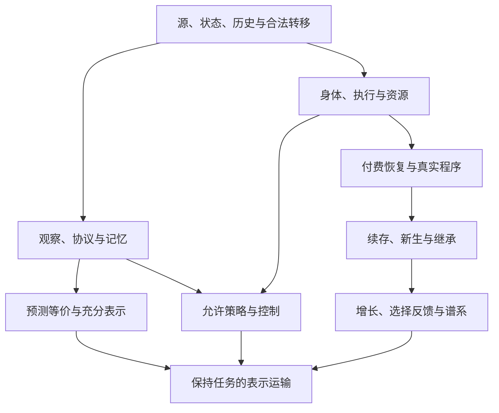

# UEOT 核心理论全体系独立审查与数学—哲学闭合性最终评估

**报告日期：2026-11-13**  
**审计对象：MurphyHoops/UEOT；固定 main 提交 cb17211653fde30aa50e0e9848798a6a5b3b3f12**  
**最终裁决：B——核心理论基本闭合，但存在少数关键缺口。**

本报告由主智能体独立综合，并组织恰好三个原生研究子智能体分别审查哲学、数学与 Lean、统一架构。三者先独立形成专业报告，再进行实际相互质询；它们是同一模型家族的分离任务审查，不等于三位独立人类学者的同行评议。主智能体承担最终论证和裁决责任。

## 第一章：执行摘要

### 1.1 当前达到的程度

**UEOT 当前最可辩护的核心，是一套受到明确数学条件约束的关系性客体哲学，以及一套组织预测、干预、资源、控制、恢复、继承和表示的形式框架。它已不只是概念纲领或互不相干的模型目录；但也没有证明所有现实对象遵守同一种自再生、双驱动、唯一优化或必然进步规律。**【E1；S03、S04、S05、S14—S17；主审推论】

其最坚实的进展有三项。第一，现行著作公开区分模型存在与现实存在、预测等价与个体身份、期望增长与逐路径存活、功能与规范价值。第二，关键数学端点有可追踪定义、真实前提、非空消费者和边界反例。第三，最新同源主线把可损坏身体中的实际程序、付费恢复、合法请求、原个体续存、新生个体、继承、人口增长及合法商连接起来，减少了“每个模块各自假设成功”的问题。【E1；S03 总论与§34—35；S04 前言及附录；S06、S07、S14—S17】

尚不能直接选 A 的主要原因，是**现行最高层宪章与 canonical claims 仍保留普遍 Ω 自再生、普遍 Π/Φ 耦合优化、必有 GOD/GOA 等强承诺，而最新版哲学、数学与后继合同已经公开收窄它们。**没有找到在当前仓库内明确解决其权威和含义关系的新决议。这个问题影响下游对“UEOT Core 到底要求什么”的理解，不能靠继续增加 Lean 定理解决。【E1；S08、S09、S10 对照 S03、S04、S05】

主审将其列为 **P1：正式主张与概念合同的关键缺口**，不称为已经证明的 Lean 内部矛盾。旧 Ω 因果/组织环与操作失效族不是同一数学类型；两个定性关切也不等于共同光滑二维因子。因此，不能仅凭“空失效族”“秩三响应”就声称同一套形式公理推出了矛盾。必须处理的是当前正式文件仍允许两种不相容的强弱读法。哲学组首审将此列 P0；其理由及主审不采用该严重度的裁决完整保留于交叉质询记录。【E1；主审逻辑判断】

### 1.2 是否继续扩张

**建议现在停止以“核心还不够大”为理由的自动扩张，保持当前数学源码冻结；完成一次有限的宪章—规范—书籍协调和一处来源矩阵前提勘误后，冻结范围明确的正式学术 Core。**本轮没有识别出必须新增的核心公理、必须再造的总定理，或一批不可替代的新 Lean 证明。【E1/E2；主审判断】

这不是说所有相关问题已经解决。它表示：未知参数学习、更广的连续源、完整自创生、意识、规范伦理、量子结构和真实领域机制识别，并非当前已声明条件 Core 的共同成立条件。把这些重新列成 Core 永久待办，会让“闭合”失去可终止的含义。

后续最有价值的投入是：固定版本的外部复现；针对准确贡献的文献比较和人类同行反驳；在一个实际领域验证 Core 的假设是否成立，以及相对常规方法是否增加解释或预测能力。并不优先增加模块、证明数量或术语。【E1-L/E4；研究决策】

### 1.3 可信边界

本轮重新核对当前源码、关键声明、全部登记端点的静态映射、历史编译回执与当前文件哈希，并做了独立精确数学计算。**本轮环境没有可运行的固定 Lean 工具链，用户的 Mac 离线，故没有新的 Lean 内核编译或新的公理打印成功记录，也未核验 Mac 当前未提交修改。**本报告不把历史成功记录写成本轮 fresh PASS。【E1/E2/E4；第二、六章】

没有发现占位证明或任意自定义公理，不等于对全部数学作绝对一致性证明。数学正确、哲学可辩护、经验真实和原创优先权始终分开。

## 第二章：审计现场与证据

### 2.1 固定现场

| 项目 | 本轮核定值及含义 |
|---|---|
| 正式仓库 | https://github.com/MurphyHoops/UEOT |
| main HEAD | cb17211653fde30aa50e0e9848798a6a5b3b3f12 |
| Git tree | 921f87cbbdcd11d1c2fa79cc9424aa095e3c6914 |
| HEAD 时间 | 2026-11-12 01:22:10 UTC；最新合并 #460，为物理元数据整合 |
| 远端目录树 | 8,875 条目，递归响应未截断；未发现仓库 AGENTS.md |
| 当前数学著作 | 中英文 v4.1；40 章、附录及核心总论；#453 已合并 |
| 当前哲学著作 | 中英文 v3.0；30 章、四附录；#452 已合并 |
| 冻结数学原文 | Core Mathematics v3.0；106 个 P-ID；原文 SHA-256 为 ed00dd102157cdafe3a79c45506e86dc574d6cba65feb2df8686e63ce2726303 |
| 后继合同 | Successor Specification v1.0；30 个 CSX 合同；#456 已合并；不是擅自发布 Core v4 |
| Lean 项目 | formalization/ueot-core；公共入口 UEOT.lean；通常从此目录执行 lake build UEOT |
| Lean 版本 | leanprover/lean4:v4.33.1 |
| Mathlib 锁定 | 0df444a360eaa60ab8c11dca51a86af692955474 |
| 工作状态 | 当前闭合登记为 CLASSIFIED_CORE_CLOSED；经验层仍为 UNVERIFIED |
| PR / Issues | 首次核验无开放 PR；#302、#146 仍开放，正文含较旧检查点，不能据此判数学仍 OPEN |

上述取自当前 GitHub API、README、正式索引、工具链锁定和精确文件字节；证据保存在 REMOTE_STATE、REMOTE_TREE、PR_ISSUE_STATE、SOURCE_INDEX 等 JSON 中。【E1】结束阶段于 2026-11-12 18:18:37 UTC（北京时间11月13日02:18:37）再次核验：main 未变、无开放 PR、两项 Issue 仍开放，Mac 仍离线；见 REMOTE_RECHECK.json。裁决始终绑定上述不可变提交。

本轮阅读了当前 README、贡献和正式入口规则、core/status、后继合同、核心验收包及 council 文件。没有将最早附件、旧 SHA 或历史工作树名当成有效定本。最近 #441—447 的机制、分类、同源闭合及增长参数工作已纳入，#456 后继规范对数学和哲学采用关系也已纳入。物理最新合并用于定位现场，不作为 Core 证明。

### 2.2 本地与历史材料

用户给出的 /Users/murphyhoops/Documents/ueotlean 和 total-kernel-memory-20261023 仅作线索。可见设备 MurphydeMacBook-Pro.local 离线，无法核验其分支、worktree、未提交差异或缓存。云端另有 HEAD 相同的物理工作副本，含进行中的未提交物理改动；本轮没有修改、重置或把这些改动纳入 Core 判定。【E1/E4】

审查使用隔离的只读源码快照。来自缓存或远端的文件均以 Git blob 哈希对照当前远端树；最终清单的5,124个已取证文件全部与远端blob相符；这明确区分“已取证字节”与“已逐行阅读”。快照不是完整 Git checkout，未把因缺 Git 元数据而不能运行的仓库验证器假装成成功或数学失败。

附带的旧论文与开放矩阵有历史价值：它们解释早期强主张和曾经的研究压力，却不能覆盖 v4.1/v3.0 和最新 CSX 的完成状态。历史 OPEN、PLANNED 或个别已关闭任务不自动成为当前缺口。

### 2.3 证据等级

| 级别 | 含义 | 不能被理解成 |
|---|---|---|
| E1 | 本轮绑定当前 HEAD 的原文、源码、精确声明及可复算推导/计算 | 源码阅读本身就是新内核验证 |
| E1-L | 实际查读的原始学术文献或作者/出版方原始资料 | 已穷尽全部相关先行成果 |
| E2 | 历史成功执行、公理打印、构建日志与当前字节重新绑定 | 本轮在独立平台重新执行成功 |
| E3 | 作者登记、解释性定位或尚未独立增强的原创性主张 | 已由证据链证明 |
| E4 | 外部经验、离线本地状态、优先权等未确定事项 | 已经证伪，或必须成为 Core 新任务 |

“建议”“成熟度”“解释力”是主审判断，均说明依据的证据等级；不是额外的数学命题。

### 2.4 实际覆盖和限制

A 完整阅读现行中英文哲学 Markdown 全文，包括 30 章、附录和注释。B 对 1,051 个生产 Lean 模块、106 个冻结 P-ID 及其 163 个登记端点做全量静态与哈希检查；对关键预测、Ω、二维瓶颈、控制、HJB、装配、再生增长及表示链做深入类型和假设审查。C 检查 30 个 CSX 的定义、前提、量词、结论、失败条件和消费者，独立构造十类反模型。主审直接读取关键著作和源文件，独立重建增长上界与边界算例，审查哲学—数学桥接及文件权威。【E1/E2】

没有声称重新证明全部约 21 万行 Lean，也没有逐句完成整部双语数学著作的翻译等价认证。物理只检查正式入口和 Core 接口；GI 没有纳入。没有将合成精确算例称为自然实验。

## 第三章：UEOT 最小理论骨架

### 3.1 最小核心是什么

向专业数学家与哲学家解释当前 UEOT，最少需要下列六项输入和四项连接，而不是先接受“任何对象都必然优化”的命题。【E1；S03 总论、§31—35；S05 §§2.1—2.4】

| 层次 | 最小内容 | 理论地位 |
|---|---|---|
| 哲学背景 | 一个非任意的共同世界；某些持续实体可按关系与过程理解 | 可争论的实在论/自然主义承诺，不是 Lean 推出的现实存在 |
| 实际源 | 状态/历史、初态、时钟、合法转移、随机噪声或连续律 | 建模前提；必须可实例化 |
| 认识和行动权限 | 观察、协议、允许记忆、可用动作、行动先于未知新噪声 | 模型的一部分，不可把隐藏真值交给控制器 |
| 实现与资源 | 身体、执行器、成本、支付顺序、损伤、修复和外供 | 行动可实现性条件 |
| 身份与组织任务 | 要保留的个体、生成来源、响应、可行域、恢复目标 | 任务和角色须定型；不是一个无条件身份谓词 |
| 评价与表示 | 收益/风险/增长等比较目标，允许策略类，表示所保持的测试 | 额外明确输入；不由存在自动生成 |

四项必要连接是：源到观察响应；允许策略到真实执行；真实执行到身份/资源/人口记录；表示映射到同一任务与策略的保持。缺少这些桥，确实只能得到几个相邻模型。现行体系已有多个一般桥和一个较强的同源纵向实例，因此不能简单判为“只有重新命名”。【E1；S11、S14—S17、S07】

### 3.2 真实依赖图

下图是本轮从源码重建的概念依赖，不是新添的 UEOT 公理；箭头代表需要履行的数学条件和桥。

组织不是仅由观察产生，控制也不是仅由信息产生；评价、资源与实现规则需要额外输入。规范意义和现实存在不在图的末端自动出现。

### 3.3 原语、定义、定理、解释与经验如何分开

以同源再生类为例：

- 身体的六位码、门、bootstrap、每体资本和每期外供、噪声原子及请求菜单，是实际源的给定结构。
- 健康/受损、解码、付费修复、retained/newborn、人口和程序策略，是在源上的定义。
- 执行一致性、继承保持、期望行矩阵、全允许策略上界、参数 iff 和合法商运输，是需要证明的结论。
- 把这些理解成“受资源与信息约束的组织维持及再生”，是有限且可讨论的哲学解释。
- 某生物、物理器件或社会系统实际符合这些条件，是另外的经验/应用责任。

把最后两项写在 Lean 定理旁边，不会自动提高它们的证据等级。【E1；S03 总论；S04:194—220、1007—1013；S14—S17】

### 3.4 四个压缩生成器不是四条宇宙公理

QD（商降落）、TC（误差运输）、OI（占据极限不变性）、PE（正特征结构）是登记的数学复用路线。现行账本实际分类为 **11 个生成、89 个适配、6 个边界**，总计 106。它没有证明四个独立本体公理演绎出所有 Core，也没有证明这组生成器在一切可能形式化语言下绝对最小。删除某个生成器会影响登记推导路线，但标准概率、控制与矩阵事实并不因此失真。【E1；S26、S28；S03 §32】

数学体系无需为了满足“统一”再包一层总 record，把所有成功结论放进字段。合理的最小性是：保留当前公共主张实际需要的源、权限、评价和桥，去掉重复包装和未履行的普遍承诺。

## 第四章：哲学基础审查

### 4.1 客体、存在与同一性

现行哲学将核心立场表达为关系性客体实在论和过程自然主义。它允许事件、闪现等真实存在而不要求全部满足持续组织条件，因而已避免用特定操作证书垄断“存在”的资格。对象边界与问题有关，不意味着任意命名都同样成功；响应、传播、干预和维护条件仍能使某种划分失败。【E1；S04:32—44、74—84、102—114】

然而，模型成功并不能唯一推出这种实在论。工具主义或其他温和实在论也可能接受相同预测。UEOT 的哲学立场需要独立辩护，不能把“存在一个满足定义的数学结构”写成现实存在的证明。这是哲学立场之间的欠决定，不是新增 Lean 任务。

现行著作区分预测等价、历史延续与严格数值同一；复制后功能相同不等于同一历史，分叉继承也不使两个后继严格等同一个前身。这一澄清成立，但尚不是所有生命、人格、制度和物理对象的唯一身份理论。【E1；S04:142—156；S03 §34.1】

六种数学角色——预测身份、形成来源、相互作用区分、构成性持续、物理可恢复性、语义身份——应作为不同问题的证据关系使用。将它们强行合为一个无条件谓词，反而会把“后代扩张”误当“创始个体永续”。现行区分是合理的范围控制，不是自动放弃同一性问题。

### 4.2 演化、组织与 Ω

如果“演化”只指任何状态变化，它排除的情形很少，单凭该词没有足够解释力。实质内容来自允许与禁止的转移、信息限制、资源约束、机制保持、增长区域及不可能性。静态核、循环和衰退都可以属于广义动力学，不能再由这种资格推出必然发展。【E1；S04:166—176、518—528、772—792；C 反模型 CM6】

当前 Ω 已明确相对于失效谓词、可用干预和时间尺度。删除因素可能解除抑制，故失败未必单调；干预族可能根本触及不到受保护读出，故 Ω 可能为空。最小失败超图、因果反馈、几何闭环和生物自生产是不同概念，不能互相借名完成证明。【E1；S12；S04:120—138】

付费恢复模型证明某些组织可在保留信息、受信任恢复底座和外部供给下恢复实际执行。它没有证明组织从全无支撑状态产生，也没有给出生命的充分必要条件。当前书稿已经承认这些限制，不应重复把它们登记成未闭合项目。【E1；S04:194—220；S03 总论；S14】

### 4.3 信息、记忆、因果和机制

UEOT 当前最有价值的澄清之一，是同一记录可能足够支持一种任务而不足以支持另一种：零风险可行性、概率预测、价值排序和身份辨别有不同充分性。扩大可观察实验或动作集合，也可能破坏原来的合法压缩。【E1；S04:230—246；S05 的观察、控制与表示合同】

历史增广可以给马尔可夫表示，但不证明原来的低维变量已经封闭；观察不可区分也不意味着微观机制相同。控制定理需要的状态信息不能凭分析者知道就交给机制使用。以上都是认识与因果解释的实质边界，而不是术语差异。

信息的统计结构、语义、真理与价值不相同；这并非 UEOT 首创。Shannon 1948 的工程问题本就把语义含义与传输问题分开。UEOT 的贡献应在于把这个区分持续带入资源、执行和组织的具体合同，而不是重新命名后宣称推导了意义。【E1/E1-L；S04:365—371；L05】

### 4.4 目的、选择、意义与规范性

当前文本区分功能贡献、选择历史、自维持作用、控制目标、反思意图和规范承诺。人口增长可以解释特定程序在指定环境中的相对扩张；它不能推出该程序短期最好、创始体永存或道德上正确。【E1；S04:315—349、439—455、550—562】

伦理部分公开承认附加规范理由：从我重视自己的痛苦，不能仅靠形式逻辑推出我必然同等重视所有人的痛苦。人生意义也没有被还原为一个增长标量。这避免了直接的事实—义务跳跃，但代价是伦理与意义论并非由核心数学独家推导。该代价应当接受，不应以新形式化包装隐藏。【E1；S04:664—710；Hume L06 为原始论证参照】

意识、自主和价值的未决争论属于哲学解释的开放边界。它们可以作为明确承担论证责任的哲学章节定稿；只要不宣称已经得到充分机制定理，就不自动阻止当前数学冻结。

### 4.5 哲学评价

现行哲学具有可发表的连贯立场、可辨识的反对意见和自我修正机制。其独立价值更接近：把对象、信息、组织、行动与规范放入明确分层的共同讨论，允许数学反例约束哲学措辞。它尚未建立一个排除所有竞争形而上学的证明，也未证明独有经验解释增益。【E1/E1-L；主审判断；原创性与经验增益 E4】

## 第五章：数学体系审查

### 5.1 定义是否非空、非平凡，是否把结论放进假设

现行核心并非一个每个字段都已包含成功性质的空泛 record。它包括有实例的核、可执行有限源、具体损伤和支付机制，并能在同一参数类内区分成功与失败。例如再生增长分类不仅给有利点，还给两个内部程序达到最优底数的 iff 区域。这比假设某程序最优再证明它最优强得多。【E1；S15—S17】

仍须逐定理区分假设类型：

| 情形 | 审查结果 |
|---|---|
| 预测充分性假设所有协议通过同一统计量因子化 | 结论是联合可测/几乎处处的最小因子性质；并非无条件存在低维充分统计 |
| 二维瓶颈先给在同一点可微的共同二维因子 | 秩上界有内容，但不能作为二维因子总存在的证明 |
| HJB 给候选值函数、局部不等式及 ItôRun | 验证定理，不直接给任意 SDE 解与候选函数；没有直接把“全局最优”放入字段 |
| P-CORE-01 给共同误差、分离、商与控制条件 | 给同时成立的证书；不自行证明这些部件来自同一个真实身体 |
| 原再生 Valid 含增长优势和超临界条件 | 是原正例范围；后续 ProbabilityValid 已拆出纯概率域，并给参数分类，不能继续批评为只有预设成功 |

【E1；B 追踪矩阵；S11、S13、S15—S17；DiffusionHJBVerification.lean】

### 5.2 三条最容易被过度解释的定理

**P-OMG-01。**实际内容是：对有限删除集 D 和向上单调 Failure，

\[
Failure(D)\iff\exists C\subseteq D,\quad C\text{ 是极小失败集}.
\]

它不假设也不推出任意失败集存在。Failure 恒假完全合法。其价值是失败结构的有限最小化，而不是“所有存在者必有自再生环”的普遍本体证明。【E1；S12:20—45】

**P-DDH-04。**所有响应 m_r 先通过同一个可微 z:X→R² 因子化，m_r=g_r∘z，才由链式法则推出堆叠响应 Jacobian 秩≤2。它提供可否定共同二维模型的必要条件；不保证任意世界都可二维表示，也不把局部秩条件自动升级为全局非线性因子存在。【E1；S13:114 及定义】

**P-CORE-01。**它在共享好事件和匹配的预测、动作、控制、误差和裕量条件上装配证书，概率下界采用失败风险合并。这有接口整合价值，但最外层装配不是“任何客体自动具备全部性质”的存在定理。各泛型类型可来自不同模型；真实共同来源仍需专门桥接，最新同源类承担了部分这种责任。【E1；S11:518—769；S03 §31.1】

### 5.3 最强正面证据：同一程序、身体、钱包与人口源

当前源的程序实际存储在两组三位码中，执行门和码会损坏；恢复使用保留冗余与 bootstrap，不直接读取一个隐藏“正确程序”参数。每体一单位资本、每期五单位外供；受损态修复费为三，care/bloom 的费用不同。D/bloom 请求超预算而真实拒绝，保留原体并按规则退款；它不是在推导最优值时删除的“不方便动作”。在合法身份输入下，新生个体具有可证明的新鲜身份和父指针，不能把复制偷换为原体续存；任意泛型初始人口不自动满足身份良构性。【E1；CoreRegenerativeSource.lean；S03 总论；S14、S17】

从 36 原始噪声原子和实际事件得到的均值矩阵，继续连接继承、人口控制和表示运输。因此 growth/fitness 并非完全自由指定的另一份输入。只删除静默 tag 的商保持动作、收据、身份和联合记录；删除 H/D 或执行门则不再是同一合法任务。这里有真正的结构统一。【E1；S07；CoreRegenerativeQuotient.lean、CoreRegenerativeControlPopulation.lean；S05 CSX-25】

但 bootstrap、冗余、外供和环境规律仍给定。固定源上的联合实现并不推出现实中的任意对象都具有相同构造；不同初始实验也不能因“同源”而被说成同一初态。

### 5.4 主审独立重建的增长证明

记实际两型均值为

\[
k_c=s+b,\qquad k_b=s-\delta+b+\gamma,\qquad
\lambda_1=(1-q)k_b+qk_c.
\]

在当前严格正概率域、明确钱包和完整允许策略类中，最优统一期望增长底数为

\[
R=\max\{1,k_c,\lambda_1\}.
\]

这里的“统一”要求上界常数对允许策略共同适用；初态固定且非空。它不是对任意历史策略证明增长极限都存在，也不是逐路径永存保证。【E1；S15—S17】

为了独立核查最关键的一步，主审没有仅重复原检查器，而从请求行重新写出正权重的 Bellman 作用。令 K=max(k_c,k_b)，ν=(1−q,q)，对正向量 v=(v_H,v_D)，令 S=ν·v，则

\[
(Tv)_H=K S,\qquad (Tv)_D=\max\{k_cS,v_D\}.
\]

第二式的 v_D 来自真实拒绝保留原体，不能漏掉。设 r=(1−q)K+qk_c，则 R=max(1,r)。若 r≥1，取 v=(K,k_c)；若 r<1，取

\[
v=\left(\frac{Kq}{1-(1-q)K},1\right).
\]

分母在后一域严格为正。直接代入得 Tv=Rv。于是每一请求行均满足加权期望≤R 倍当前权重，并有允许请求取得等号；混合和历史依赖不破坏逐步条件期望不等式。对人口加和后得到统一上界，取等策略与正权重的上下界给出匹配下界，再排除任何更小的统一指数底数。

这个推导说明结论没有藏在“最优性”假设中；真正的内容是源行结构、拒绝菜单与正权重的分域构造。完整一般证明依项目定理及其回执，主审推导是独立逻辑复核，不冒充新 Lean 证明。

本轮还用 Fraction 精确算术核查 3,087 个严格正有理参数点、每点七个期限；没有发现违例。有限枚举只用于发现实现/公式错误，不承担连续参数全称证明。脚本与输出见 verification/root_growth_probe.py 和 ROOT_GROWTH_PROBE.json。【E1；新独立核验】

### 5.5 参数、时间尺度与可实现性边界

在合法临界点

\[
(s,\delta,b,\gamma,q)=(1/2,1/8,1/4,1/2,1/3)
\]

有 k_c=3/4、k_b=9/8、λ₁=R=1。从受损创始体出发，内部 θ₁ 程序每个正整数时刻的期望人口均为 3/4；一直提交被拒绝的 D/bloom 则保持 1。两者指数同为 1，有限期限表现却不同。由一阶段均值 3ν/4 和 νM=ν 可严格推出全时结论，有限复算只作核对。【E1；主审推导与脚本】

这并不反驳当前增长定理。它禁止把“达到最优指数”写成“每一期人数最多”。同理，正期望增长不意味着初始个体不死，不意味着群体几乎必然不灭绝，更不意味着在固定小 cohort 中高增长程序必胜。当前两书已经承认这些区别。【E1；S03 总论；S04:339—349、427—431；C 反模型 CM8—CM9】

### 5.6 数学风险逐项结论

| 风险 | 现行核查结论 |
|---|---|
| 存在性被读成普遍性 | 同源正例只证明非空参数类；当前文本明确范围 |
| 有限推广无限 | 有限支持综合、有限 cohort 与连续/长期源分开；无统一无条件推广 |
| 特定点推广全参数 | 新增长结果有严格正域 iff；零概率边界不自动包含 |
| 局部最优充当全局 | 有限折扣结论覆盖对应全部因果策略；HJB 为条件全局验证；不存在无评价全局最优 |
| 构造存在充当可执行 | 实际支付、允许信息及恢复程序给出特定实现；一般数学存在仍需应用桥 |
| 可识别/可观察/可控混同 | 当前支持和误差合同区分；隐藏模式反例有效 |
| 组合自动合法 | 需共同资源与保持映射；局部可行不推出共享钱包全局可行 |
| 模块同名即同源 | P-CORE-01 本身不够；最新实际源桥构成额外正证据 |
| 每项数学都为原创 | 不成立；标准概率、谱、Bellman、距离等贡献须分别定位 |

【E1/E2；B 两份数学报告与追踪矩阵；C 反模型报告】

## 第六章：Lean 形式化审查

### 6.1 本轮到底核验了什么

B 对 1,051 个生产模块剥离嵌套注释、行注释和字符串后扫描，核对导入图和登记端点；全部模块从公共 import UEOT 可达，未发现无法解析的内部导入。106 个冻结 P-ID 的 163 个登记声明，文件哈希、声明 token 和公共导入路径匹配。【E1；STATIC_LEAN_INTEGRITY.json】

| 项目 | 结果 | 证据解释 |
|---|---:|---|
| sorry / admit / sorryAx 源码位置 | 0 | 静态扫描范围内未发现占位 |
| 自定义 axiom 声明 | 0 | 未发现任意新增理论公理 |
| opaque、unsafe、extern、implemented_by 或所扫内核绕过手段 | 0 | 不等于对任意恶意编码作完备安全证明 |
| native_decide | 2 | 已披露的有限计算端点，见下节 |
| 新 Lean 构建/公理打印 | 未执行 | 固定运行时不可用；不能写 fresh PASS |

官方 Lean 文档明确区分：内核接受某形式命题、依赖哪些公理、该形式命题是否表达预期自然语言，是不同检查责任。因此，这里不以“没有 sorry”或“构建过”替代语义审查。【E1-L；L01】

### 6.2 历史编译证据如何使用

PR444 的生产清单含 1,048 个模块，当前 1,047 个文件 SHA-256 不变；唯一变动的 CoreTheoryClosure.lean 已由后续 PR447 回执覆盖。后者的三个新增增长模块、受影响入口和边界检查文件，均与成功编译回执中的源哈希匹配。后继规范 26 组源/回执绑定也重新计算并匹配。【E1/E2；HISTORICAL_RECEIPT_REVALIDATION.json】

旧全入口构建日志退出码 0，日志哈希匹配，但其 clean_full_rebuild=false，是使用既有缓存的集成构建。PR444 的 59 个公理端点记录及 PR447 的 15 个关键端点，披露标准 propext、Classical.choice、Quot.sound。它们不等于项目人为假设“UEOT 正确”。回执仍是项目保存的历史记录，本轮只完成字节与记录重绑定，没有制造独立编译事实。【E2】

### 6.3 两个原生计算依赖

RegisterMechanismDecisionConsumer.lean:119、130 使用 native_decide，分别处理 H3/H2 的冻结有限数据。对应历史公理审计明确记为 PASS_DISCLOSED_NATIVE_REDUCTION，相关精确最坏后悔/数值合同会传递依赖生成的 _native 公理项；其他一般证书或身份/支付桥不因此全部受同一依赖影响。【E1/E2；B Lean 报告第四节】

这不是 sorry，也不是完全相同于普通内核归约的信任范围。如果发表渠道要求更窄信任基，可仅为这两个有限计算提供内核证书，这是按需 P2；没有理由为此重做全部 Core。

### 6.4 自然语言到定理的代表追踪

| 自然语言主张 | 数学/Lean 端点 | 实际前提与限度 | 分级 |
|---|---|---|---|
| 预测状态具有相对最小性 | PredictionDependent.canonical_ae_minimal | 可数协议、共同统计、可测 a.e. 因子化；非现实个体本质 | K2 |
| 合法压缩保持控制问题 | 精确/近似商、同源记录运输端点 | 动作、观察、初态、费用与相应交换；任意压缩不成立 | K2；同源桥对纵向主张为 K1 |
| 单调失效由极小失效重建 | p_omg_01 | 有限删除集、单调性；不保证非空 Ω | K3 |
| 公共二维模型有秩上界 | p_ddh_04 | 已有在指定点可微的共同二维因子 | K2（作为边界检验），非普遍自然律 |
| 有限折扣 greedy 最优 | p_ctl_01_causal_optimality | 有限非空动作、0<β<1、指定奖励和因果策略 | K2/K3 |
| 多类证书可在共同好事件上装配 | p_core_01 | 共享条件与匹配接口；外层合取本身不是新的基础存在性 | K2/K3 |
| 同一受损程序恢复并取得增长界 | same_program_regenerates_and_attains | 原 Valid 类、同身体/程序/支付；外层共同见证连接重要子结果 | K2 |
| 全允许策略有精确最优底数及程序 iff | optimalRate_isLeast_uniform_upper；true/false_program_attains_iff | ProbabilityValid、非空初态、真实允许策略和外供 | K1 |
| 忠实继承、有限 cohort 反馈和谱系一致 | 同源 Feedback/Lineage 公共消费者 | 给定继承、独立出资、固定时域量词；不是创新或必胜 | K1/K2 |

这里 K1 意为对 UEOT 当前有区别性的纵向解释不可随意删除，**不表示它的证明不使用标准数学，也不表示世界范围原创优先权已经确立**。K2 为重要桥；K3 为支持性结果；K4 为展示或固定有限实例；K5 为重复包装或可直接复用标准结论的低收益再证明。具体声明、文件位置、前提和依赖详见 B 的完整追踪矩阵。【E1/E2；主审分级】

固定有限实例不一定都应降为 K4：若它首次证明此前分离的实际信息、付款和身份接口能共同实现，它承担 K2 的非空桥接作用。反之，泛型定理名称宏大也不自动是 K1。

### 6.5 没有 Lean 端点的内容是否必须补齐

现行 API 明示：固定四初态的 2/3/4 任务分割分类、(s,b,bq) 秩三边界以及指数双边界的正次根/limsup 分析推论，有书面证明而没有相应完整专用 Lean 端点。它们未被冒称为已经形式化。【E1；S25】

没有发现这些简短书面证明需要新公理才能成立。若没有下游机器消费者，继续形式化的理论增益较低，列 P2/P4 按用途判断。哲学意义、现实存在和伦理理由更不应通过增添空洞形式定义来伪造覆盖。

有一处真实勘误：THEOREM_SOURCE_MATRIX.md:82 将 P-CTL-01 前提写成 0≤β<1，而冻结原文、当前数学正文及 Lean Model 均为 0<β<1。应将矩阵更正为严格正折扣；不必修改核心模型来迁就矩阵误写，也不应扩大为全部 106 项来源失效。【E1；S18、S21；B 主报告】

## 第七章：哲学—数学一致性

### 7.1 “同一套理论”的准确判断

**若“同一”指哲学每句话都能翻译为 Lean 中一个等价命题，答案是否。若指哲学使用有来源、有权限、有失败条件的数学机制，并接受其反例对解释的约束，当前两部著作已基本做到。**这种分层统一有合理价值，但不能宣称哲学已被数学唯一推出。【E1；S03、S04、S05；主审分析】

数学从协议、源、评价和保持条件出发；哲学从现实主义、对象关系、功能和价值理由出发。桥接成立的位置，是“哪一结构证据支持哪一种有限解释”，不是用同名词替代推导。当前最大偏差仍在旧宪章与新合同的关系，而不是两部新书全盘互相冲突。

### 7.2 A—F 概念对应矩阵

A=在已给类型内充分表达；B=条件性表达；C=存在不能直接合并的表达；D=哲学论述；E=不宜/无需完全数学化；F=实质冲突。复合分类表示一个词承担不同角色。

| 哲学概念 | 分类 | 数学对应和剩余责任 |
|---|---|---|
| 客体 | B + D/E | 六类操作角色和真实机制证书；不是所有现实存在的唯一判定式 |
| 存在 | A（模型）+ D/E（现实） | 非空实例、策略和分布存在可证明；现实指称须经验与哲学论证 |
| 同一性 | B/C + D/E | 预测等价、历史、谱系、严格身份不同；六角色明确区分后并非 F |
| 演化 | A/B | 合法过程、因果策略、变化和选择可定义；无无条件进步律 |
| 关系与环境 | B | 交互核和组合接口；因果、相关、组成须分别履行 |
| 信息 | A/B | 相对协议的响应律、充分性、信息界；不自动等于语义或真理 |
| 记忆与历史 | B | 历史增广、后验与支持；何种记忆足够依任务而定 |
| 组织与边界 | B | 载体、失效、可行域、实际恢复；不保证非空 Ω 或唯一自然边界 |
| 持续 | B/C | 不变、可行、幸存、同个体和期望人口的量词不同 |
| 再生与生成 | B | 指定损伤、信息、底座与支付下恢复/形成/新生；不等于无条件自创生 |
| 选择与适应 | B | 实际输出、忠实继承、有限群体反馈；适应依目标和环境 |
| 因果与机制 | B | 同源执行、干预和实现桥；观察律相同不足以识别机制 |
| 目的 | B + D/E | 控制目标/组织功能可分析；评价选择和反思意图另有责任 |
| 意义与规范 | D/E，局部功能 B | 不从增长或稳定性推出道德；需要明确规范理由 |
| 跨尺度 | B | 保持指定任务的商/运输；不自动保证所有宏观压缩合法 |
| 同名核心跨文件 | C，存在未协调的强弱冲突 | 当前书籍受限义与宪章强义需正式映射；尚未证明形式体系 F |

【E1；S03 §34；S04 相关章节；S05；A 概念矩阵】

### 7.3 最关键的桥接裁决

第一，**预测可区分性不是存在条件**。一个统计模型可合并两个现实不同的机制，或因任务不同分出多个类；这不决定世界中“到底有几个实体”。当前书籍已允许这种区别，故不构成恶性循环。

第二，**恢复不是同一性的全证明**。恢复同一编码、身体记录和执行有严格内容，但尚需约定何种身份关系适用；后代继承不是原体永生。新人口源记录原体与新体，已经消除最危险的偷换。

第三，**目标与规范不由可实现性生成**。Bellman、增长和最优表示各相对于评价。选择给出在条件下的分布变化，不给价值理由。当前伦理承认额外前提，故无需寻找一条“由演化推出应当”的核心定理。

第四，**同源不是同名**。源、实际动作、付款、观测、身份及策略均保持，才可把几个结果解释成同一过程的不同方面。现有 CoreTheoryClosure 和实际记录商给予实质正面证据；P-CORE-01 单独不足以承担全部这项责任。【E1；S11、S14—S17；主审独立裁决】

## 第八章：原创性与现有理论关系

### 8.1 逐领域定位

本轮使用原始论文、作者文本和官方版本资料，避免用“类似”二字取消贡献，也避免以跨学科范围自动证明原创。以下是有限而可核查的比较；对只取得原刊摘要者明确标明范围，未声称穷尽优先权检索。【E1-L；A 原创性矩阵】

| 先行领域 | 已有成熟内容 | UEOT 当前可合理主张的增量 |
|---|---|---|
| 过程哲学 / Whitehead | 生成、关系和过程性的形而上学，远早于 UEOT | 协议化对象辨认、精确机制与形式边界的结合；不是首次发现过程性【L09】 |
| 一般系统论 | 跨领域系统结构、开放性和相互作用的统一研究 | 使共享概念承担更细的来源、权限和保持责任；统一雄心本身不是新【L08】 |
| 动力系统 / 开放系统 | 行为、互联、共享变量及系统—环境关系 | 明确哪些身份、成本和任务在互联后仍保持；不能把“过程+环境”独占【L14】 |
| 控制论 / 可行性 | 反馈、信息限制、必要多样性、可行核和受限控制 | 具体部分观察、资源和内部实现桥；不能把控制需信息或维持需可行策略笼统称为新发现【L07、L13】 |
| 随机过程 / 预测状态 | 最小预测充分态、因果状态与输入输出 transducer | 可数协议、可测版本和同源控制/任务接口的精确组织；需逐定理比较【L02、L03】 |
| 信息论 | 不确定性、传输、编码及与语义问题的区分 | 使不同充分性任务与动作/成本条件不混用；不是重新发现信息与意义不同【L05】 |
| 演化动力学 | 遗传、繁殖差异、Price 分解、多型分枝和增长优化 | 实际编码、支付、身份和噪声导出增长/反馈的联合消费者【L11、L19、L20】 |
| 组织 / 自维持 | 自创生网络、组织与结构区分、约束的相互维持闭合 | 可损坏代码的付费恢复与不可恢复边界；有限恢复不等于完整自创生【L04、L10】 |
| 范畴与组合 | 开放网络组合、装饰余跨度、动力学与黑箱语义映射 | 特定模型的资源和记录保持；无需为名义统一新加万能范畴层【L15、L16】 |
| 形式本体论 | 模块化形式公理、关系与时间化关系、模型一致性资料 | UEOT 的操作角色、过程证书与 Lean 接口；未证明优于或等价于所有现有本体【L17】 |
| 科学 / 结构实在论 | 理论更替中结构连续性的论证 | 将它与对象划分和实际机制辨认分开，构成关系实在论的可争论版本【L18】 |

### 8.2 对增长主线更直接的先行比较

主审额外检索到两项比泛称“Perron 理论”更接近当前增长主线的来源。

Pliska（1976）原刊摘要明确把受控多型分枝过程的期望奖励优化联系到非负矩阵的广义 Markov 决策问题。Rothblum 与 Whittle（1982）研究从有限、可独立选行的非负矩阵族中选择矩阵的增长最优性，原刊摘要说明存在重复使用的矩阵达到最佳几何增长及相应代数增长。【E1-L；L19、L20；本轮读到原刊摘要，PDF入口返回摘要，未声称完整复核证明】

这足以否定“将分枝人口增长化为受控非负矩阵问题”本身是 UEOT 首创。它尚不足以断言两篇论文与 UEOT 的全部信息、支付、内部损伤、身份及历史策略接口完全等价。

基于第五章的独立 Bellman 重建，主审判断 UEOT 这一增长公式的抽象优化方法属于成熟的正算子/动态规划谱系。可能的新意应精确放在：源的实际可执行构造、拒绝与支付语义、同一程序的恢复和继承、特定参数域的闭式分类，以及这些部分的机器可检验连接。**这是贡献定位的收窄，不是数学可靠性的否定。**【E1/E1-L；主审推论；完整原创优先权 E4】

### 8.3 哪些内容可算独立贡献候选

| 内容 | 本轮分类 | 尚缺什么才能提出更强原创主张 |
|---|---|---|
| 距离 1-Lipschitz、概率界、链式秩、Bellman/Perron 等 | 标准数学或标准结果的形式化适配 | 应归因，不再通过改名制造独立定理声誉 |
| 六种对象角色、权限/资源/身份合同 | 新定义/操作组织及有价值的统一 | 证明使用这些区分能减少实际错误或提高解释；无需证明世界唯一分类 |
| 同源恢复—内部执行—增长—继承—表示 | 具体模型与结构桥的贡献候选 | 与受控分枝、程序验证、组织维持文献逐条对照输入和新增输出 |
| 2/3/4 任务表示、同源最优准则冲突 | 清楚的精确案例/反例；一般原则有先行 | 不应将任务相对最小性的基本思想当新发明 |
| 数学反例促使哲学撤回强主张 | 方法与哲学论证组织贡献 | 外部评议其解释增益；不是实在论被数学唯一推出 |
| “UEOT 已是唯一或完整普遍基础理论” | 无充分证据 | 当前材料不支持；不应作为冻结版本定位 |

因此，可以说 UEOT 有独立可研究的组织结构和具体成果；不能给出“已证世界首创”的总印章。原创性不足以完全确定，不等于理论没有价值，也不意味着继续增加无关定理就能补足它。

## 第九章：关键反例与理论边界

### 9.1 现行体系已经吸收的反例

以下反例由 B、C 和主审独立构造、展开或精确复算；许多已在当前书籍登记。本轮将其记为已确认边界，不冒称新发现，也不重开旧任务。【E1】

| 编号 | 反模型/严格理由 | 排除的强主张 | 对当前 Core 的影响 |
|---|---|---|---|
| R1 | 一点自环或二点恒等核 | 合法过程必有非平凡发展/优化 | 广泛语言允许退化；无当前矛盾 |
| R2 | q(x,u)=x，允许切割只改变 u，失效族为空 | 任意持续预测对象必有非空操作 Ω | 需任务/干预前提；现行书已收窄 |
| R3 | 两隐藏机制给所有允许观察完全相同的未来律 | 观察等价即微观机制相同 | 逆向不可识别边界，不是未完成证明 |
| R4 | q(a)=q(b)，但 a 留在该类、b 转到另一类 | 任意观察压缩自动为 Markov 商 | 缺 lumpability/保持条件时失败 |
| R5 | 同一观察下隐藏 L/R，需要相反安全动作 | 全状态可控即可在允许观察下安全控制 | 最坏成功率≤1/2；oracle 不可偷渡 |
| R6 | 两局部动作各费1，共享钱包只有1 | 局部可行必能联合实现 | 必须重证资源组合；现行已要求 |
| R7 | 活态单步存活1/2，存活条件化后为自环 | 条件存活律就是可实现永存控制 | 无该允许动作；当前 killed/control 分开 |
| R8 | 两原程序完全擦除成同一输入 | 不保留信息也能普遍恢复原程序 | 任意解码器不能同时恢复两个不同目标 |
| R9 | θ₁ 增长指数最优但当期原体存活较低，或临界期望人数3/4<1 | 一个“最优”同时优化身份、短期人数与长期增长 | 评价不同；现行已经区分 |
| R10 | 高增长 founder 首期零后继概率9/64 | 期望优势保证固定小群体必胜 | 高程序可灭绝；先固定T再增大cohort数的结论仍成立 |
| R11 | F(s,b,q)=(s,b,bq)，Jacobian 行列式 b>0 | 所有响应有共同光滑二维表示 | 共同可微因子假设不可省；不反驳定性两关切 |
| R12 | 两态交替链无逐时分布极限；恒等链有多个不变律 | 总有唯一吸引子或唯一 GOA | Cesàro、不变律、QSD、最优闭环需分型 |
| R13 | 等权两型 z=(0,1)、w=(2,1)，均值从1/2到1/3 | Price 恒等式自动推出进步 | 协方差为负；恒等式本身不含改进符号 |
| R14 | 比特预测器、独立 Unit 控制链、实线失败距离满足分离装配假设 | P-CORE-01 独自证明共同身体 | 装配≠同源；具体纵向消费者提供额外桥 |

完整构造、当前准确来源与可运行精确脚本见 B/C 反例报告。R11 的结论只排除相应正则性和开域上的共同二维精确因子，不能推到任意非连续编码；R10 不表示低增长程序永久存活；R2 的操作失效族不等同一切可能的本体因果环。

### 9.2 真正尚需修正的当前问题

**G1：现行权威与含义未协调，P1。**宪章自称不可改写的核心，canon 仍将强命题标为 canonical；最新版两书公开修改其强读法，council 的现行架构决议仍把 constitution 作为治理根。当前树没有找到明确继承与收窄决议。影响是下游使用者不能仅靠正式路径判断：自再生 Ω、Π/Φ 耦合优化和必须给出 GOD/GOA 的旧义，对哪些当前实例仍具有约束，以及它们如何对应现行失效结构、二维表示和长期对象的条件合同。【E1；S08:5—7、34—62、104—114；S09；S10；S04:40；S05】

宪章本身也已说明哲学承诺、数学证明与物理规律不自动继承地位；本审查没有指控它把所有承诺直接宣布为 Lean 定理。问题在于旧义与当前准入范围缺少明确映射。该问题应由一份有明确旧义→新义→状态→证明范围的有限决定解决，不需要新增模型。其本质既有治理层又有语义层，不能仅改 README 的一句“完成”。

**G2：P-CTL-01 矩阵的 β=0 边界误写，P2。**精确改为 0<β<1 即可，正文与源码不动。它不会使现有证明无效，但会使只按矩阵调用的人遇到范围不符。【E1；S18；B-M01】

**G3：本轮缺少独立固定版本执行，P2 复现限制。**有充分字节与历史回执证据支持当前证明沿用，仍不能声明本轮完成了新内核验证。这是审计可复现证据的边界，不是已识别的数学缺口。【E1/E2/E4】

### 9.3 身份和形成的特别限定

交叉质询后又核对了一个容易误述的地方：retained_identity 主要是构造的定义性事实；newborn_fresh 需要 ValidIdentity。任意 ControlPopulation.State 只约束 canonical 身体，并不自动排除所有初始 ID 重复或时间无效。合法单 founder 消费者和带 hvalid 的新生定理没有因此失效。【E1；CoreRegenerativePopulation.lean；CoreRegenerativeControlPopulation.lean；B/A 交叉记录】

同样，Formation 的 Finset PhysicalCell 候选来自实际出生响应的载体最小化；身体本身是源给定的，永久身份是另一个类型。不能把“形成一个相应读出的最小载体”写成“从无组织材料生成全部身体和身份”。当前书籍保留了这些区别。

本轮因此要求正面结论写成：**在声明源和合法身份输入下，真实执行、留存/新生记录、程序继承和相关评价具有一致的桥接证明。**这比“所有初态自动有全局唯一真实身份”弱，但更准确，也足以支撑现行有限主张。

## 第十章：核心闭合性判断

### 10.1 四种闭合不能互相替代

| 闭合种类 | 最终判断 | 证据与限度 |
|---|---|---|
| 形式闭合 | 当前条件合同达到合理闭合；本轮形式核验受 E2 限定 | 定义、端点、依赖与回执可追踪；未发现占位/任意自定义公理；没有本轮新内核 PASS |
| 结构闭合 | 基本闭合，有实质而有界的统一 | 一般条件桥与同源纵向参数类成立；所有不同分支并非一个自然源的推论 |
| 解释闭合 | 对当前声明的条件机制解释基本闭合；全仓最高声明尚需有限协调 | 实在论与规范由独立哲学论证承担，意识等未完成解释不计入已证明核心；反例能约束哲学 |
| 范围闭合 | 当前 CSX/API 边界充分；正式入口需同步 | 已区分书面、Lean、经验与应用；强旧义不能继续支配下游 |

【E1/E2；主审综合裁决】

### 10.2 逐领域状态

“条件性完成”指在明确论域中有完整义务与结果，不是把所有问题重新判为 OPEN。

| 领域 | 状态 | 关键理由 |
|---|---|---|
| 对象身份与持续 | 条件性完成 | 六角色、合法身份输入、同一路径与群体量词分开 |
| 合法动作与可实现机制 | 条件性完成 | 完整允许类、真实拒绝、信息先后顺序与执行桥 |
| 信息边界与控制 | 条件性完成 | 充分性、支持综合、可识别与可控不混同 |
| 资源约束 | 条件性完成 | 均值条件、逐前缀支付及每体外供各自有范围 |
| 再生、复制与增长 | 指定严格正参数类内完成 | 同程序修复、全策略上界、参数 iff；不包括任意损伤与零边界 |
| 选择反馈 | 条件性完成 | 实际出生和忠实继承；固定T/增大cohort数，非无条件无限期必胜 |
| 组织生成与机制演化 | 核心已有局部/条件性完成；更强生成属非核心必需 | 最小载体与具体身体来源分开；创新需要新的变异/生成机制 |
| 表示相容 | 条件性完成 | 保持任务、权限、费用、身份和记录；不同任务有不同最小表示 |
| 不可识别性 | 已有充分边界 | 同观察不同机制，不要求理论恢复不可能信息 |
| 组合与层次 | 条件性完成 | 同源、同资源和交换图约束；任意拼接不在保证内 |
| 随机与连续 | 分模型条件性完成 | 各有可测、正则和来源合同；不声称任意过程通吃 |
| 极值与参数分类 | 指定域完成 | 全策略与内部程序 iff、评价和严格概率域清楚 |
| 意义、意识、终极存在 | 非必须全面数学化 | 哲学论证/经验问题；不能作为不断扩充 Lean 的理由 |

【E1/E2；S03、S05、S06、S25；A/B/C 专项报告】

### 10.3 Universal 五种强度

| 主张 | 判定 |
|---|---|
| 提供广泛适用的数学语言 | 支持，E1；有多类条件实例 |
| 统一描述多种演化系统 | 条件性支持，E1；须履行各自源和接口 |
| 推出跨领域非平凡共同定理 | 条件性支持，E1/E2；控制、充分性、运输等可复用，但非全为 UEOT 原创 |
| 解释现实中所有对象的存在与演化 | 未建立，E4；当前著作亦不应如此解读 |
| 是唯一可能的基础理论 | 无证据，E4；不是合理冻结主张 |

前三级已经足以形成研究框架。后两级不是前三者的逻辑后果，也不应被理论名称替代论证。

## 第十一章：是否需要继续扩张

### 11.1 优先级总表

**当前没有确认的 P0 数学基础矛盾；有一项必须在全仓正式冻结前解决的 P1，若干有价值的 P2，其余多数属于 P3、P4 或 P5。**如果额外坚持旧强义与被反模型否定的数学强义完全同义且仍无条件为真，才触发新的 P0 主张修正；那不是本轮替创立者擅自增添的承诺。【E1；主审判断】

为逐一回答委托中的十个决策问题，下面两表以同一方向编号联结；分别覆盖“缺什么/级别/自洽影响/损害主张/可复用”和“文字修复/Lean/新增能力/反例/停研损失”。

| 方向 | ①具体缺失 | ②级别 | ③是否破坏自洽 | ④不修损害什么 | ⑤现有可复用成果 |
|---|---|---|---|---|---|
| D1 正式主张协调 | 旧宪章与当前条件合同的权威、同名语义及适用性映射 | P1 | 未证形式矛盾；全仓语义/准入不一致 | “核心究竟是什么”的可判定性 | 两书已完成的收窄、30 CSX、现行反例 |
| D2 β矩阵勘误 | 0≤β<1 与实际严格正前提不符 | P2 | 不破坏正文和证明 | 来源矩阵准确性 | 现有 Model 和正文 |
| D3 外部固定版复现 | 本轮缺新的内核/公理执行 | P2 | 不是数学不自洽证据 | 独立可复现可信度 | 版本锁、回执、公开检查请求 |
| D4 精确贡献比较 | 3—5 个主贡献与最接近先行定理逐项对照 | P2 | 无 | 原创性宣传可信度 | 现有证明与原始文献 |
| D5 简短书面结论进 Lean | 2/3/4、秩三、次根等专用端点 | 当前 P4；有消费者时 P2 | 无 | 仅影响机器调用 | 现有书面证明及标准分析 |
| D6 扩大数学参数/源 | 零概率端点、更多程序、一般连续族 | P2/P3 | 无 | 不能对新增范围套用旧结论 | 现有分域方法、标准可测/谱理论 |
| D7 更强自创生/新机制生成 | 当前身体/boot/变异来源仍给定 | P3 | 无，当前文本已承认 | 不能解释所有组织起源 | 当前恢复、形成、不可恢复边界 |
| D8 真实应用与参数识别 | 自然数据是否满足模型、未知参数能否识别 | P3 | 无 | 经验解释与比较效果 | 统计、逆向、控制和接口合同 |
| D9 宇宙唯一目的/二维/总定理 | 这些强主张并未成立，部分被反例排除 | P4；强行坚持则 P0 主张修正 | 只有偷渡强义才破坏体系 | 应放弃不受支持宣传 | 已有边界足够 |
| D10 已完成历史端口 | 没有新反证；旧任务曾经 OPEN | P5 | 无 | 重开反而消耗资源 | S/C/P 系列当前验收与后继绑定 |

| 方向 | ⑥是否可只改文字/范围 | ⑦是否真正需新增 Lean | ⑧合理新增能力 | ⑨可能反例/不可能性 | ⑩停止后的实际损失 |
|---|---|---|---|---|---|
| D1 | 是，需明确正式继承决定而非口号替换 | 否 | 下游能唯一判断适用合同 | Ω 不同类型、二维/定性关切混读 | 若不做则正式核心持续含糊；必须有限完成 |
| D2 | 是，改矩阵为严格正 | 否 | 准确调用条件 | β=0 无现行 Model 字段 | 微小但可避免的误导；建议顺手完成 |
| D3 | 无需改理论 | 不需新证明；需独立运行已有检查 | 更强独立验证证据 | 工具/缓存/依赖异常 | 少一次复现证据；不重开数学 |
| D4 | 主要改贡献论证与归因 | 否 | 明确可以投稿的真正增量 | 原结果可能是已知定理实例 | 无法稳妥声称原创；值得做，非闭合缺口 |
| D5 | 当前标注已足够 | 暂不需 | 机器消费者可直接调用 | 过度工程，接口无人用 | 仅损自动调用便利，理论损失很低 |
| D6 | 限制范围即可 | 有实际新消费者时才需 | 新论域覆盖 | 可约性、非紧性、无正权重等 | 不能覆盖该新增域，不损当前定理 |
| D7 | 保持“给定底座下”即可 | 需新科学模型才有形式任务 | 更强组织起源解释 | 全擦除、无能量、忠实复制无创新 | 当前有限解释不变；停止无普遍解释承诺损失 |
| D8 | 不能用文字代替数据 | 按实际应用，非默认 | 自然实例与比较预测 | 不可识别、源假设不满足 | 没有经验效力证明；不能反向虚构 Core 失败 |
| D9 | 必须收窄，不能靠新增公理救宣传 | 不应 | 无可靠新增能力 | 静态、非唯一GOA、rank3、评价冲突 | 没有已获理论能力损失 |
| D10 | 保持准确状态与追踪 | 否 | 无需新增 | 只有新实质反证才重开 | 无损，节约重复工程 |

### 11.2 数学与哲学停止规则

只有出现下列一种具体理由，才建议再开核心研究：当前正式保留主张有反模型；某 K1/K2 实际消费者无法履行已承诺接口；必要定义不一致；已保存证明无法在固定工具链复现且问题落在源而非环境；或一个有明确增益、已说明代价的新主张经过单独立项。单凭“还有更多数学可以证明”不是理由。

对哲学同样如此：可以保留有争议的现实主义或规范立场，但应明确其论证与竞争观点。无需为了追求不存在的终极无争议状态而无限增补概念。

## 第十二章：下一阶段研究决策

### 12.1 冻结前的有限工作包

建议的完成条件只有三类，均已有具体内容可审阅：

1. **正式协调当前强弱主张。**把普遍 Ω、Π/Φ、GOD/GOA 和强制生命周期，逐项标为哲学纲领、条件假说、操作定义、已证明结果或已收窄历史主张；同步 constitution、canonical claims、glossary、method 和正式导航。附带 MINIMAL_CORRECTION_PROPOSAL.md 给出可审阅文本；本轮不直接覆盖冻结定本。
2. **修正已确认的前提勘误。**将 P-CTL-01 来源矩阵改成 0<β<1；不改变原数学语义。
3. **发布一个准确证据包。**保持源码/书籍/规范 SHA、固定工具链、历史与新执行身份、标准/原生信任范围、书面未形式化条目及应用边界。已有大量材料可复用；本轮已组织证据索引与最小检查文件。

其中第一项是 B 尚未升到 A 的关键；第二项是低成本勘误；第三项提高可评审性。本报告已给出完整裁决，不将“以后再全面审查”当交付。

### 12.2 不建议继续做的工作

不再为了数量重新证明标准数学；不再把所有哲学概念强行变成 Lean 类型；不再追求一个从几个本体词推到所有科学的总定理；不重开没有新反证的 S0—S6、C1—C5 或机制/表示历史端口；不把物理未完成自动回填为 Core 债务。更高成本的形式化只随清楚的消费者需求开展。

### 12.3 应用合法使用的条件

物理接口当前把 Core、桥、扇区、标准物理输入、有效假设、观测后果和开放猜想分层。它明确 Core 不独自强制完整量子结构，并区分 Object-RG、过程粗粒化与 Wilsonian RG；应用不能把自己加入的结构静默提升为 Core。【E1；S20:17—62、80—107、149—160】

因此，物理、生物、认知或经济应用可以使用当前 Core，但须提交以下有实质内容的映射：哪个实际系统对应哪个源；哪些信息和动作真实可用；资源、时间与身份如何计算；所用表示保持哪些观察和评价；新增经验或领域假设是什么；失败会否推翻应用模型还是 Core 定理。

数学同构或相同方程只能说明某种结构关系。若测量解释、单位、干预权限或经验连接不同，不能直接称为物理等价。此次只读接口检查支持该原则已经存在，不保证整部物理书每项推导都已满足它。

### 12.4 发表与长期研究

建议先选最清楚的数学/机制贡献形成可外部审阅的有限论文：源、目标、关键桥、参数区域、反例与先行比较可以在一个可检验命题上相遇。哲学定本应呈现其独立立场和受数学约束的位置，不再宣称全部哲学已被形式证明。

长期基础已经存在：稳定公开对象、可追踪命题、反例与明示限制使他人能够反驳而不必接受整个世界观。其长期学术生命仍取决于外部研究者是否发现可复用能力、可发表增量和真实应用收益，这部分仍为 E4。理论不需要先成为唯一基础理论，才值得长期研究。

## 第十三章：最终结论

### 13.1 四选一裁决

**最终选择 B：核心理论基本闭合，但存在少数关键缺口。**

不选择 A，是因为全仓正式权威与当前收窄尚未协调；不选择 C，是因为当前保留的主要数学与机制主张已有条件桥和非空实际源，没有识别出必须重建基础架构的新缺口；不选择 D，是因为未建立同一谓词、同一量词下的形式矛盾，也未发现占位公理被当作证明。此裁决针对当前证据支持的有限版本，不替旧无条件普遍强版背书。【E1/E2；主审独立裁决】

### 13.2 委托要求的九项定本回答

| 最终问题 | 明确回答 | 证据等级 |
|---|---|---|
| 哲学是否可以正式定本 | 可以形成有界、可批评的正式哲学版本；先协调宪章和范围，不宣称 Lean 唯一推出实在论/伦理 | E1，解释判断 |
| 数学是否可以正式定本 | 当前明示条件下已足够成熟，建议保持冻结；修正文献矩阵小错 | E1/E2 |
| Lean 是否覆盖最重要核心主张 | 对大量关键数学桥及同源增长主线有强覆盖；未覆盖所有书面扩展，更不覆盖全部哲学/经验主张 | E1/E2；新运行未完成 |
| 是否还有真正必要核心证明 | 本轮未识别出新的不可替代生产 Lean 任务；优先现有证明的独立复现与语义校准 | E1/E2，审计判断 |
| 是否必须改基础公理或定义 | 当前条件数学无此证据；正式宪章的强义及同名映射必须明确重分类 | E1 |
| 是否形成实质统一理论 | 已形成共享语言、一般条件桥及主要同源纵向实例；不是所有命题互译或万物由一源导出 | E1/E2 |
| 最重要未解决问题 | 内部是正式主张一致性；外部是准确原创性、自然实例与比较解释增益 | E1 / E4 |
| 现在是否冻结 Core | 停止自动扩张、保留数学冻结；有限完成 P1 协调后冻结正式范围版本 | E1/E2，决策 |
| 最佳后续投入 | 外部复现与人类同行评议、精确贡献对照、一个实际领域的假设验证 | E1-L/E4，决策 |

### 13.3 对最高目标的完整回答

UEOT 当前成立为有条件且有实际机制连接的研究框架，而非已证明的普适存在律。哲学与数学共享若干核心问题和解释约束，但不具有全部命题的等价翻译关系。当前主要风险是把这些不同层次重新混同；已有反例和 API 大体防止了这种混同，最高层文件仍需完成最后协调。

最重要的肯定不是证明数量，而是实际身体、程序、信息、资源和人口主线可以在一个非空源中接起来，并能在同一源里说明其何时最优、何时失效。最重要的否定也不是“有限模型太小”，而是任何有限或条件结果都不能自动承担普遍 Ω、二维本体、唯一目的和规范正确性。

**现在应当停止无目的核心扩张。**完成已明确、有限、主要属于正式主张协调的工作后，UEOT 可以以诚实限定的学术版本接受外部批评。是否将来扩大范围，应由具体新反例、新消费者或新经验问题驱动，不由“普适”名称驱动。【E1/E2/E4，分别如上】

## 附录 A：交叉质询的实质结果

完整记录见 CROSS_EXAMINATION_AND_ADJUDICATION.md 及 A/B/C 各自交叉文件。这里保留影响裁决的四项：

1. **P0/P1 分歧。**A 首审将宪章问题列 P0；C 与主审要求同谓词同量词矛盾。A 接受现有证据只证明当前权威/语义合同未协调，修正为 P1；冻结前有限动作不变。主审采用 P1。
2. **P-CORE-01 的等级。**B 首审对装配端点的 K1 定位偏高；C 展开分离的 H/X/Obj 类型并给异源实例。B 接受最终应为 K2 接口、K3 外层包装。其内部同商值误差与宏间隙认证微动作仍有非重述内容。主审把 K1 留给承担独立核心能力的实际推导，不给外层包装。
3. **身份与形成。**A 质询 B 后确认留存标识有定义性部分，新生新鲜性需 ValidIdentity；Formation 载体不等于整个身体起源。主审将所有正面身份陈述限定到声明源及合法身份输入。
4. **Π/Φ 类型。**C 精化首审修复建议：若仅表示两类定性关切，应列哲学纲领；若表示共同二维数值因子，才有低秩、锚与正则条件。rank3 不得跨类型当普遍反证。

这些不是多数票。每次修改都对应具体类型、文本和反模型，初审报告保留原样，最终以本综合裁决和交叉记录解释。

## 附录 B：原始学术来源

以下是综合报告自己的编号，与 A 专项矩阵编号不同。仅作有限转述；阅读范围披露于末列。

| 编号 | 文献与可核查链接 | 本轮使用范围 |
|---|---|---|
| L01 | Lean 官方：[Validating a Lean Proof](https://lean-lang.org/doc/reference/latest/ValidatingProofs/) | 内核、依赖公理与自然语言语义的区别；latest 文档不替代项目4.33.1版本回执 |
| L02 | Shalizi & Crutchfield (2001). Computational Mechanics: Pattern and Prediction, Structure and Simplicity. J Stat Phys 104:817–879. [作者原文](https://csc.ucdavis.edu/~cmg/papers/cmppss.pdf) | 最大预测性、最小充分性及先行结构；非 UEOT 全端点等价证明 |
| L03 | Barnett & Crutchfield (2015). Computational Mechanics of Input–Output Processes. J Stat Phys 161:404–451. DOI 10.1007/s10955-015-1327-5. [作者稿](https://csc.ucdavis.edu/~cmg/papers/et1.pdf) | 输入输出、记忆通道和预测模型；所读作者稿标2016修订，不混作出版年 |
| L04 | Montévil & Mossio (2015). Biological Organisation as Closure of Constraints. J Theor Biol 372:179–191. [作者全文](https://montevil.org/publications/articles/2015-mm-organisation-closure-constraints/) | 过程/约束、时间尺度、相互依赖与闭合 |
| L05 | Shannon (1948). A Mathematical Theory of Communication. BSTJ 27:379–423,623–656. [原文](https://marco-dalai.unibs.it/teach/IT/shannon_1948.pdf) | 通信工程与语义问题区分 |
| L06 | Hume. A Treatise of Human Nature, 3.1.1.27. [原文](https://davidhume.org/texts/t/3/1/1) | 从事实关系到应当关系须说明额外论证；不声称禁止所有自然主义伦理 |
| L07 | Ashby (1956). An Introduction to Cybernetics. [作者遗产站原文](https://ashby.info/Ashby-Introduction-to-Cybernetics.pdf) | 状态、转换、调节和必要多样性的明确条件 |
| L08 | von Bertalanffy (1950). An Outline of General System Theory. BJPS 1(2):134–165. [DOI](https://doi.org/10.1093/bjps/I.2.134)；[原文节选](https://www.isnature.org/Events/2009/Summer/r/Bertalanffy1950-GST_Outline_SELECT.pdf) | 核跨域系统同构和统一计划；节选不冒称全篇 |
| L09 | Whitehead (1929). Process and Reality. [原版馆藏](https://commons.ptsem.edu/id/processrealityes00whit_1) | A 核相关范畴转录与现行书归因，主审核书目；不以全文已读自居 |
| L10 | Varela, Maturana & Uribe (1974). Autopoiesis: The Organization of Living Systems, Its Characterization and a Model. BioSystems 5:187–196. [原文](https://users.sussex.ac.uk/~inmanh/adsys10/Readings/Varela_etal_-_1974_-_Autopoiesis_the_organization_of_the_living_characterization_n_model_-_Biosystems.pdf) | 自生产、组织/结构与复制的区分 |
| L11 | Price (1970). Selection and Covariance. Nature 227:520–521. [原刊](https://www.nature.com/articles/227520a0) | 文献身份；本报告反例协方差独立计算 |
| L12 | Givan, Dean & Greig (2003). Equivalence Notions and Model Minimization in Markov Decision Processes. Artificial Intelligence 147:163–223. [作者原文](https://cs.brown.edu/people/tdean/publications/archive/GivanetalAIJ-03.pdf) | 带奖励的随机等价和最优策略提升 |
| L13 | Aubin (1991；2009重印). Viability Theory. [出版社](https://link.springer.com/book/10.1007/978-0-8176-4910-4) | 核成熟方向及书目/目录；未重核全书证明 |
| L14 | Willems (2007). The Behavioral Approach to Open and Interconnected Systems. IEEE Control Systems Magazine 27(6):46–99. [作者原文](https://homes.esat.kuleuven.be/~sistawww/smc/jwillems/Articles/JournalArticles/2007.1.pdf) | 共享变量、开放系统及输入输出建模限制 |
| L15 | Fong (2015). Decorated Cospans. [作者原文](https://www.cs.ox.ac.uk/files/7074/DecoratedCospans.pdf) | 网络组合及语义构造；未据此宣称 UEOT 全部等价 |
| L16 | Baez & Pollard (2017). A Compositional Framework for Reaction Networks. Rev Math Phys 29:1750028. [作者原文](https://math.ucr.edu/home/baez/RxNet.pdf) | 开放反应网络、动力学、稳态黑箱映射 |
| L17 | BFO Developers Group. BFO 2020. [官方版本](https://bfo-ontology.github.io/bfo-2020.html) | 模块化逻辑和一致性模型入口；未逐公理比较 |
| L18 | Worrall (1989). Structural Realism: The Best of Both Worlds? Dialectica 43:99–124. [作者原文](https://usercontent.one/wp/johnworrall.org/wp-content/uploads/2023/08/1989b.pdf) | 理论更替中的结构连续；非对象唯一划分定理 |
| L19 | Pliska (1976). Optimization of Multitype Branching Processes. Management Science 23(2):117–124. [原刊](https://pubsonline.informs.org/doi/abs/10.1287/mnsc.23.2.117) | 原刊摘要的受控多型分枝与非负MDP联系；未全文证明复核 |
| L20 | Rothblum & Whittle (1982). Growth Optimality for Branching Markov Decision Chains. Mathematics of Operations Research 7(4):582–601. [原刊](https://pubsonline.informs.org/doi/10.1287/moor.7.4.582) | 原刊摘要的独立选行矩阵增长最优性；不据摘要判与UEOT全部接口等价 |

## 附录 C：仓库证据索引

以下均链接到同一个不可变提交。完整 Git blob、SHA-256 和字节数见 evidence/SOURCE_INDEX.json；具体行位在专业报告和本报告正文中给出。证据来源之间发生冲突时，本报告已显式说明，而未以旧 canonical 标签取消当前源码事实。

| 编号 | 精确当前文件 |
|---|---|
| S01 | [README.md](https://github.com/MurphyHoops/UEOT/blob/cb17211653fde30aa50e0e9848798a6a5b3b3f12/README.md) |
| S02 | [core/status/CURRENT.md](https://github.com/MurphyHoops/UEOT/blob/cb17211653fde30aa50e0e9848798a6a5b3b3f12/core/status/CURRENT.md) |
| S03 | [mathematics/UEOT_MATHEMATICS.md](https://github.com/MurphyHoops/UEOT/blob/cb17211653fde30aa50e0e9848798a6a5b3b3f12/mathematics/UEOT_MATHEMATICS.md) |
| S04 | [philosophy/UEOT_PHILOSOPHY.md](https://github.com/MurphyHoops/UEOT/blob/cb17211653fde30aa50e0e9848798a6a5b3b3f12/philosophy/UEOT_PHILOSOPHY.md) |
| S05 | [core/specifications/successor/UEOT_Core_Successor_Specification.md](https://github.com/MurphyHoops/UEOT/blob/cb17211653fde30aa50e0e9848798a6a5b3b3f12/core/specifications/successor/UEOT_Core_Successor_Specification.md) |
| S06 | [formalization/ueot-core/docs/compression/theory_completion/unified_closure/core_theory_closure_v1/CLAIM_STATUS.md](https://github.com/MurphyHoops/UEOT/blob/cb17211653fde30aa50e0e9848798a6a5b3b3f12/formalization/ueot-core/docs/compression/theory_completion/unified_closure/core_theory_closure_v1/CLAIM_STATUS.md) |
| S07 | [formalization/ueot-core/docs/compression/theory_completion/unified_closure/core_theory_closure_v1/CLAIM_PREMISE_CONSUMER_MATRIX.md](https://github.com/MurphyHoops/UEOT/blob/cb17211653fde30aa50e0e9848798a6a5b3b3f12/formalization/ueot-core/docs/compression/theory_completion/unified_closure/core_theory_closure_v1/CLAIM_PREMISE_CONSUMER_MATRIX.md) |
| S08 | [constitution/UEOT_CONSTITUTION.md](https://github.com/MurphyHoops/UEOT/blob/cb17211653fde30aa50e0e9848798a6a5b3b3f12/constitution/UEOT_CONSTITUTION.md) |
| S09 | [constitution/UEOT_CANONICAL_CLAIMS.yaml](https://github.com/MurphyHoops/UEOT/blob/cb17211653fde30aa50e0e9848798a6a5b3b3f12/constitution/UEOT_CANONICAL_CLAIMS.yaml) |
| S10 | [council/resolutions/20260909-derivation-first-repository-architecture.md](https://github.com/MurphyHoops/UEOT/blob/cb17211653fde30aa50e0e9848798a6a5b3b3f12/council/resolutions/20260909-derivation-first-repository-architecture.md) |
| S11 | [formalization/ueot-core/UEOT/V3/CoreOperationalAssembly.lean](https://github.com/MurphyHoops/UEOT/blob/cb17211653fde30aa50e0e9848798a6a5b3b3f12/formalization/ueot-core/UEOT/V3/CoreOperationalAssembly.lean) |
| S12 | [formalization/ueot-core/UEOT/V3/OmegaMinimalFailure.lean](https://github.com/MurphyHoops/UEOT/blob/cb17211653fde30aa50e0e9848798a6a5b3b3f12/formalization/ueot-core/UEOT/V3/OmegaMinimalFailure.lean) |
| S13 | [formalization/ueot-core/UEOT/V3/CommonBottleneckRank.lean](https://github.com/MurphyHoops/UEOT/blob/cb17211653fde30aa50e0e9848798a6a5b3b3f12/formalization/ueot-core/UEOT/V3/CommonBottleneckRank.lean) |
| S14 | [formalization/ueot-core/UEOT/V3/Compression/TheoryCompletion/UnifiedClosure/CoreTheoryClosure.lean](https://github.com/MurphyHoops/UEOT/blob/cb17211653fde30aa50e0e9848798a6a5b3b3f12/formalization/ueot-core/UEOT/V3/Compression/TheoryCompletion/UnifiedClosure/CoreTheoryClosure.lean) |
| S15 | [formalization/ueot-core/UEOT/V3/Compression/TheoryCompletion/UnifiedClosure/CoreRegenerativeGrowthAttainment.lean](https://github.com/MurphyHoops/UEOT/blob/cb17211653fde30aa50e0e9848798a6a5b3b3f12/formalization/ueot-core/UEOT/V3/Compression/TheoryCompletion/UnifiedClosure/CoreRegenerativeGrowthAttainment.lean) |
| S16 | [formalization/ueot-core/UEOT/V3/Compression/TheoryCompletion/UnifiedClosure/CoreRegenerativeGrowthClassification.lean](https://github.com/MurphyHoops/UEOT/blob/cb17211653fde30aa50e0e9848798a6a5b3b3f12/formalization/ueot-core/UEOT/V3/Compression/TheoryCompletion/UnifiedClosure/CoreRegenerativeGrowthClassification.lean) |
| S17 | [formalization/ueot-core/UEOT/V3/Compression/TheoryCompletion/UnifiedClosure/CoreRegenerativeGrowthPopulation.lean](https://github.com/MurphyHoops/UEOT/blob/cb17211653fde30aa50e0e9848798a6a5b3b3f12/formalization/ueot-core/UEOT/V3/Compression/TheoryCompletion/UnifiedClosure/CoreRegenerativeGrowthPopulation.lean) |
| S18 | [mathematics/THEOREM_SOURCE_MATRIX.md](https://github.com/MurphyHoops/UEOT/blob/cb17211653fde30aa50e0e9848798a6a5b3b3f12/mathematics/THEOREM_SOURCE_MATRIX.md) |
| S19 | [core/specifications/successor/DOWNSTREAM_BOOK_ADOPTION.md](https://github.com/MurphyHoops/UEOT/blob/cb17211653fde30aa50e0e9848798a6a5b3b3f12/core/specifications/successor/DOWNSTREAM_BOOK_ADOPTION.md) |
| S20 | [physics/interfaces/CORE_PHYSICS_CONTRACT.md](https://github.com/MurphyHoops/UEOT/blob/cb17211653fde30aa50e0e9848798a6a5b3b3f12/physics/interfaces/CORE_PHYSICS_CONTRACT.md) |
| S21 | [mathematics/source/core-v3.0/UEOT_Core_Mathematics_v3.0_Complete.md](https://github.com/MurphyHoops/UEOT/blob/cb17211653fde30aa50e0e9848798a6a5b3b3f12/mathematics/source/core-v3.0/UEOT_Core_Mathematics_v3.0_Complete.md) |
| S22 | [formalization/ueot-core/docs/compression/theory_completion/unified_closure/core_growth_classification_v1/VALIDATION.json](https://github.com/MurphyHoops/UEOT/blob/cb17211653fde30aa50e0e9848798a6a5b3b3f12/formalization/ueot-core/docs/compression/theory_completion/unified_closure/core_growth_classification_v1/VALIDATION.json) |
| S23 | [formalization/ueot-core/docs/compression/theory_completion/unified_closure/core_theory_closure_v1/VALIDATION.md](https://github.com/MurphyHoops/UEOT/blob/cb17211653fde30aa50e0e9848798a6a5b3b3f12/formalization/ueot-core/docs/compression/theory_completion/unified_closure/core_theory_closure_v1/VALIDATION.md) |
| S24 | [formalization/ueot-core/docs/compression/theory_completion/unified_closure/core_theory_closure_v1/FINAL_ACCEPTANCE.md](https://github.com/MurphyHoops/UEOT/blob/cb17211653fde30aa50e0e9848798a6a5b3b3f12/formalization/ueot-core/docs/compression/theory_completion/unified_closure/core_theory_closure_v1/FINAL_ACCEPTANCE.md) |
| S25 | [mathematics/LEAN_API_SCOPE.md](https://github.com/MurphyHoops/UEOT/blob/cb17211653fde30aa50e0e9848798a6a5b3b3f12/mathematics/LEAN_API_SCOPE.md) |
| S26 | [formalization/ueot-core/docs/compression/COMPRESSION_LEDGER.yaml](https://github.com/MurphyHoops/UEOT/blob/cb17211653fde30aa50e0e9848798a6a5b3b3f12/formalization/ueot-core/docs/compression/COMPRESSION_LEDGER.yaml) |
| S27 | [core/specifications/successor/CLAIM_INDEX.json](https://github.com/MurphyHoops/UEOT/blob/cb17211653fde30aa50e0e9848798a6a5b3b3f12/core/specifications/successor/CLAIM_INDEX.json) |
| S28 | [core/specifications/successor/V3_PROPOSITION_INTERFACE_MAP.json](https://github.com/MurphyHoops/UEOT/blob/cb17211653fde30aa50e0e9848798a6a5b3b3f12/core/specifications/successor/V3_PROPOSITION_INTERFACE_MAP.json) |

## 附录 D：审计交付与复核

完整包包含用户要求的十一份专业报告、三份交叉质询附录、主审争议裁决、最小修正提案、当前证据清单和独立检查脚本。A/B/C 初审与交叉修正分开保存，避免事后将分歧改写成一开始就一致。Lean 检查请求文件明确标注本轮未执行；Python 精确计算与静态检查有实际输出。

本轮未提交 PR、未发布理论版本、未更改生产 Lean 或宪章。报告的成功条件是裁决和证据链，不是新增仓库改动。
